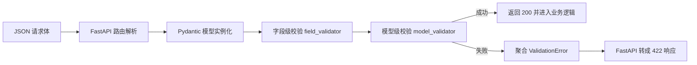

### Q099 · Pydantic v2 Field 与自定义校验器

> 难度:★★☆ | 标签:Pydantic v2, 校验

**问**:Pydantic v2 中如何自定义字段校验?v2 相比 v1 有什么重要变化?

**答**:v2 用 `Field` 声明约束(`gt/le/min_length/pattern`),用 `@field_validator` 校验单字段、`@model_validator(mode='after')` 做跨字段校验;核心引擎从纯 Python 重写为 Rust 的 pydantic-core,校验速度提升数倍。v1 的 `@validator/.dict()/.parse_obj()` 分别变更为 `@field_validator/.model_dump()/model_validate()`,v2 还内置了严格模式 `Strict` 和带类型错误聚合的 `ValidationError`。

```python
# file: code/03_Web后端开发/q099_pydantic_v2.py
try:
    from pydantic import BaseModel, Field, field_validator, model_validator
except ImportError:
    print("该题演示需要第三方库 pydantic:pip install pydantic,原理见正文")
    raise SystemExit(0)

class OrderIn(BaseModel):
    item: str = Field(..., min_length=1, max_length=50)
    quantity: int = Field(1, gt=0, le=100)
    price: float = Field(..., gt=0)
    discount: float = Field(0, ge=0, le=1)

    @field_validator('item')
    @classmethod
    def strip_name(cls, v: str) -> str:
        v = v.strip()
        if not v:
            raise ValueError('item 不能为空')
        return v

    @model_validator(mode='after')
    def check_total(self):
        if self.price * self.quantity < 1:
            raise ValueError('订单金额至少为 1 元')
        return self

order = OrderIn(item=' book ', quantity=2, price=9.9)
print(order.model_dump())   # {'item': 'book', 'quantity': 2, ...}
```

**追问**:
- field_validator 的 mode='before' 和默认区别?——before 在类型转换前拿原始输入(可做清洗),默认 after 拿已转换值;清洗与校验分开写。
- model_validator(mode='before') 用在哪?——整个 dict 级别的规范化(字段重命名、跨字段清洗),此时还是原始字典。
- v1 迁移最容易踩的坑?——`@validator` 忘改 `@field_validator`、`.dict()` 与 `.json()` 的静默弃用、conftest 里的 parse_obj 报错;官方有 bump-pydantic 迁移工具。


