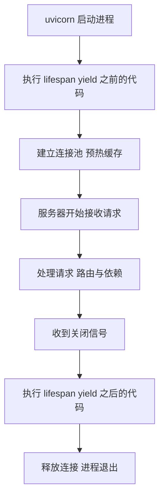

### Q105 · lifespan 与应用启动/关闭钩子

> 难度:★★☆ | 标签:FastAPI, 生命周期

**问**:FastAPI 推荐的启动/关闭逻辑怎么写?老的 on_event 为什么被弃用?

**答**:推荐用 `@asynccontextmanager` 实现 `lifespan`:yield 前是启动逻辑(建立连接池、预热缓存),yield 后是关闭逻辑(释放资源),整体作为一个协程传给 `FastAPI(lifespan=...)`。老的 `@app.on_event('startup'/'shutdown')` 已被弃用,因为它把启动关闭逻辑分散、且无法表达"有状态的异步上下文管理器"。注意 lifespan 期间不能接收请求,适合做一次性初始化。

```python
# file: code/03_Web后端开发/q105_lifespan.py
from contextlib import asynccontextmanager
try:
    from fastapi import FastAPI
    import uvicorn
except ImportError:
    print("该题演示需要第三方库 fastapi:pip install fastapi[all],原理见正文")
    raise SystemExit(0)

pool: dict = {}

@asynccontextmanager
async def lifespan(app: FastAPI):
    pool['redis'] = 'fake-redis-conn'     # startup:初始化连接池/加载配置
    print('app starting, pool ready')
    yield
    pool.clear()                          # shutdown:释放资源
    print('app shutting down, pool closed')

app = FastAPI(lifespan=lifespan)

@app.get('/cache')
def read_cache():
    return {'redis': pool.get('redis')}

if __name__ == '__main__':
    uvicorn.run(app, port=8000)
```



**追问**:
- lifespan 和 Depends(yield) 时机差在哪?——lifespan 是进程级一次性执行,Depends 是请求级执行与清理。
- lifespan 里能起常驻后台任务吗?——能,yield 前创建 asyncio Task 并保存引用,yield 后 cancel+gather 干净收场。
- 多 worker 部署时 lifespan 跑几次?——每个 worker 各跑一次;全局唯一任务(如定时器)要么加分布式锁,要么挪出应用进程。
- on_event 为什么被弃用?——分散在两个钩子、无法表达有状态的异步上下文;lifespan 一个 asynccontextmanager 全表达。
