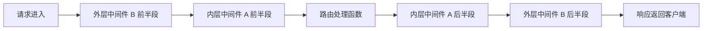

### Q107 · 中间件洋葱模型与执行顺序

> 难度:★★★ | 标签:中间件, 洋葱模型

**问**:多个中间件时请求和响应的执行顺序是怎样的?请结合洋葱模型解释。

**答**:中间件像洋葱一层层包裹路由:请求从外层向内层穿过,响应从内层向外层返回,每个中间件的 `call_next` 前半段处理请求、后半段处理响应。FastAPI 中后注册的 `add_middleware` 反而处于最外层;这与 Django 的 `MIDDLEWARE` 列表相反——Django 列表第一项最外层。理解顺序才能正确设计如"日志在外层、限流在里层"的层级关系。

```python
# file: code/03_Web后端开发/q107_onion_order.py
try:
    from fastapi import FastAPI, Request
except ImportError:
    print("该题演示需要第三方库 fastapi:pip install fastapi[all],原理见正文")
    raise SystemExit(0)

app = FastAPI()
trace: list[str] = []

def make_mw(name: str):
    async def mw(request: Request, call_next):
        trace.append(f'{name} in')
        response = await call_next(request)
        trace.append(f'{name} out')
        return response
    return mw

app.middleware('http')(make_mw('A'))   # A 先注册,处于内层
app.middleware('http')(make_mw('B'))   # B 后注册,处于外层

@app.get('/')
def root():
    trace.append('handler')
    return {'ok': True}
# 请求顺序:B in -> A in -> handler -> A out -> B out
```

**追问**:
- 为什么后注册的 add_middleware 在最外层?——注册实现是「包一层」,后包的自然在外;与 Django MIDDLEWARE 列表第一项最外层相反,跨框架容易记混。
- 限流和日志中间件谁在外?——日志在最外(记录所有请求含被拒的),限流靠内;鉴权在限流内还是外按「未认证是否计数」决定。
- 异常处理器和中间件的执行顺序?——ExceptionMiddleware 在内层处理 HTTPException,兜底 Exception 处理器在最外;中间件只能看到未处理完的异常。


