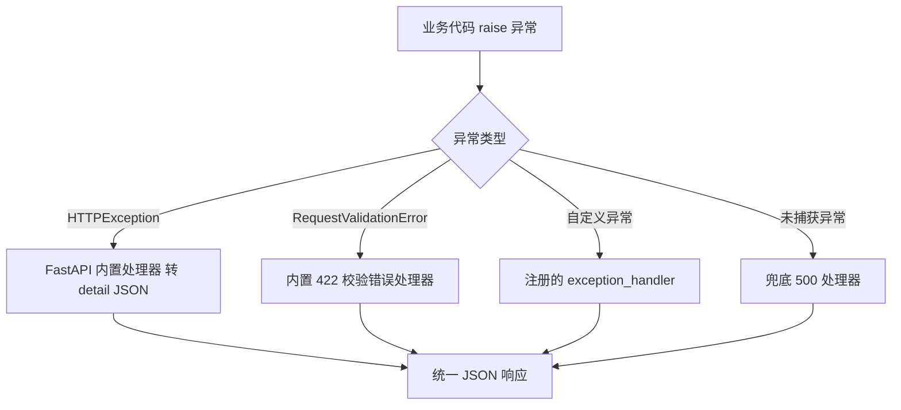

### Q111 · HTTPException 与自定义异常处理

> 难度:★★☆ | 标签:FastAPI, 异常处理

**问**:业务中如何优雅地抛出和处理 HTTP 错误?如何自定义错误响应格式?

**答**:业务校验失败直接 `raise HTTPException(status_code, detail)`,FastAPI 转成 `{"detail": ...}` 的 JSON;需要统一错误结构时,通过 `@app.exception_handler(CustomError)` 注册自定义异常处理器,返回约定格式;也可以让业务异常继承 HTTPException 携带错误码。原则:让异常沿调用栈抛出,在处理器层统一转换为响应,业务代码不拼错误 JSON。

```python
# file: code/03_Web后端开发/q111_custom_exception.py
try:
    from fastapi import FastAPI, Request
    from fastapi.responses import JSONResponse
except ImportError:
    print("该题演示需要第三方库 fastapi:pip install fastapi[all],原理见正文")
    raise SystemExit(0)

app = FastAPI()

class BizError(Exception):
    def __init__(self, code: int, message: str):
        self.code = code
        self.message = message

@app.exception_handler(BizError)
async def biz_error_handler(request: Request, exc: BizError):
    return JSONResponse(
        status_code=400,
        content={'code': exc.code, 'message': exc.message,
                 'path': request.url.path},
    )

@app.get('/items/{item_id}')
def get_item(item_id: int):
    if item_id > 100:
        raise BizError(40001, 'item not found')
    return {'id': item_id}
```

**追问**:
- HTTPException 的 headers 参数干什么用?——401 附 `WWW-Authenticate: Bearer`、429 附 `Retry-After`,标准要求放在响应头而非 body。
- 自定义异常处理器能拿到 request 吗?——能,handler 签名是 `(request, exc)`,可按路径/客户端定制响应并记录上下文。
- 业务异常该继承 HTTPException 吗?——推荐继承它携带 status_code,或自定义异常 + 处理器转换;业务层绝不能直接拼 Response。


