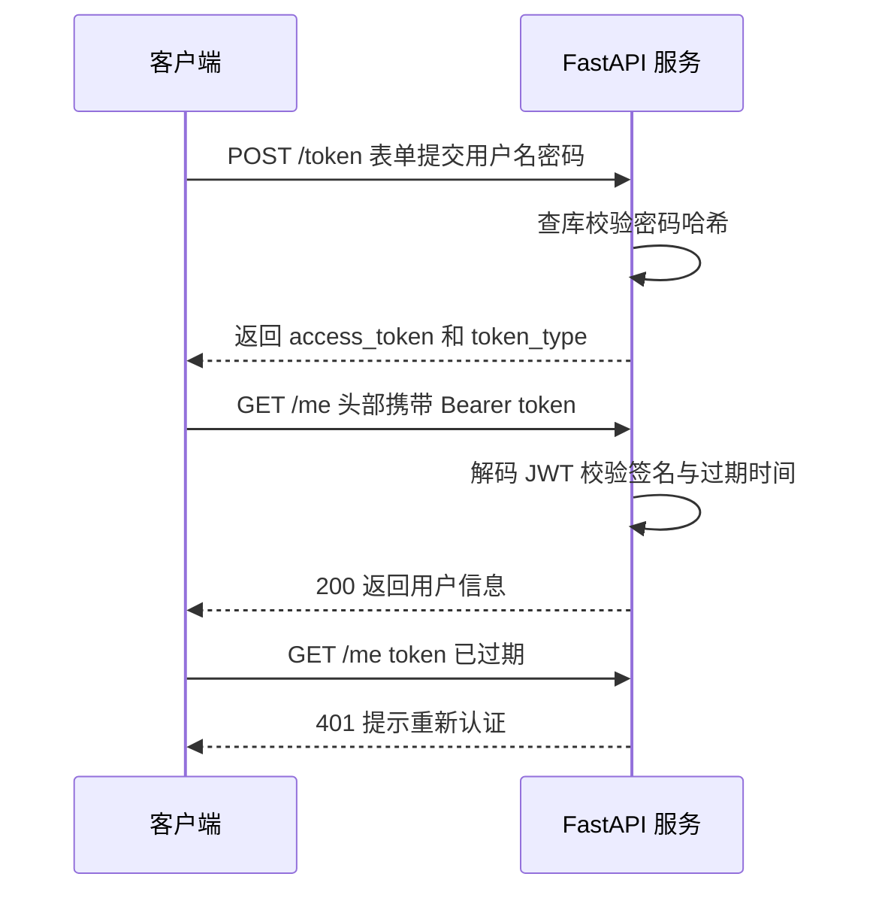

### Q113 · OAuth2 密码模式与 JWT 登录流程

> 难度:★★★ | 标签:OAuth2, JWT, 安全

**问**:描述一个 OAuth2 Password 模式 + JWT 的完整登录鉴权流程。

**答**:流程:1) 客户端 POST `/token` 提交用户名密码(表单格式);2) 服务端校验后签发含过期时间与用户标识的 JWT 返回;3) 客户端后续请求在 `Authorization: Bearer <token>` 头携带;4) 受保护接口用依赖解码 JWT 校验签名与过期,取回当前用户;5) token 过期走 refresh token 或重新登录。OAuth2PasswordBearer 只负责"提取 token"并标记 OpenAPI 安全方案,真正的解码校验在自定义依赖里完成。

```python
# file: code/03_Web后端开发/q113_jwt_login.py
from datetime import datetime, timedelta, timezone
try:
    from fastapi import FastAPI, Depends, HTTPException, status
    from fastapi.security import OAuth2PasswordBearer, OAuth2PasswordRequestForm
    from jose import jwt, JWTError   # pip install python-jose[cryptography]
except ImportError:
    print("该题演示需要第三方库 fastapi、python-jose:pip install fastapi[all] python-jose[cryptography],原理见正文")
    raise SystemExit(0)

SECRET = 'change-me-in-prod'
ALG = 'HS256'
app = FastAPI()
oauth2_scheme = OAuth2PasswordBearer(tokenUrl='token')  # 仅提取 Bearer token

def create_token(username: str) -> str:
    payload = {'sub': username,
               'exp': datetime.now(timezone.utc) + timedelta(hours=1)}
    return jwt.encode(payload, SECRET, algorithm=ALG)

@app.post('/token')
def login(form: OAuth2PasswordRequestForm = Depends()):
    # 实际项目应查库并用 passlib/bcrypt 校验哈希
    if form.username != 'alice' or form.password != 'wonderland':
        raise HTTPException(status.HTTP_401_UNAUTHORIZED, 'bad credentials')
    return {'access_token': create_token(form.username), 'token_type': 'bearer'}

def get_current_user(token: str = Depends(oauth2_scheme)) -> str:
    try:
        payload = jwt.decode(token, SECRET, algorithms=[ALG])
        return payload['sub']
    except JWTError:
        raise HTTPException(status.HTTP_401_UNAUTHORIZED, 'token invalid')

@app.get('/me')
def me(user: str = Depends(get_current_user)):
    return {'user': user}
```

**追问**:
- OAuth2 密码模式现在还推荐吗?——OAuth 2.1 已废弃密码模式,建议授权码+PKCE;面试要能说出「示例常用,生产应换」。
- JWT 放 cookie 还是 Authorization 头?——头方式免疫 CSRF 但要防 XSS;cookie 要 HttpOnly+SameSite;二选一都有对应防线,关键是说出来。
- refresh token 怎么安全轮换?——一次性使用,旧 refresh 换新时旧 token 立即作废;检测到已用 refresh 再次出现则全家族撤销(疑似被盗)。


