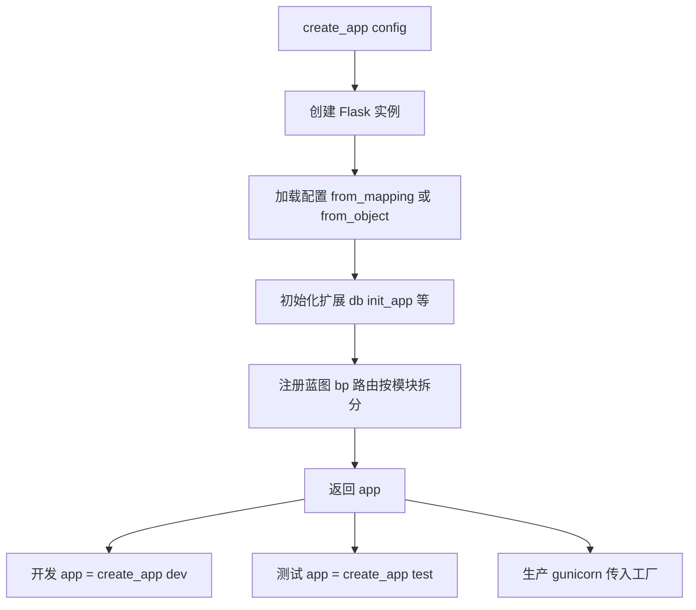

### Q116 · Flask 应用工厂模式

> 难度:★★☆ | 标签:Flask, 应用工厂

**问**:什么是 Flask 应用工厂?为什么生产项目都推荐它?

**答**:应用工厂是一个 `create_app(config) -> Flask` 的函数,把 app 创建、配置加载、扩展初始化、蓝图注册集中管理。好处:1) 支持多环境/多实例配置(测试、开发、生产各建一个 app);2) 延迟导入避免循环引用;3) 配合 Flask-SQLAlchemy 等 `db.init_app(app)` 的延迟初始化模式;4) 测试可以为每个用例创建独立 app。是官方推荐的组织大型 Flask 项目的方式。

```python
# file: code/03_Web后端开发/q116_app_factory.py
try:
    from flask import Flask
except ImportError:
    print("该题演示需要第三方库 flask:pip install flask,原理见正文")
    raise SystemExit(0)

def create_app(config_name: str = 'dev') -> Flask:
    app = Flask(__name__)
    app.config.from_mapping(
        DEBUG=config_name == 'dev',
        SECRET_KEY='dev-secret',
        DATABASE='app.db',
    )

    @app.get('/health')
    def health():
        return {'status': 'ok', 'env': config_name}

    return app

app = create_app('dev')

if __name__ == '__main__':
    app.run(port=5000)
```



**追问**:
- Gunicorn 如何运行工厂?——`gunicorn "myapp:create_app('prod')"` 直接引用工厂调用。
- 工厂模式怎么支持多环境?——`create_app(ConfigClass)` 按环境注入配置对象;测试传 TestConfig 覆盖数据库与密钥。
- 工厂里延迟导入解决什么?——循环引用:扩展对象模块级创建、init_app 时绑定;导入顺序不再敏感。
- gunicorn 怎么引用工厂?——`gunicorn 'myapp:create_app("prod")'` 调用表达式,gunicorn 负责 import 并调用。
