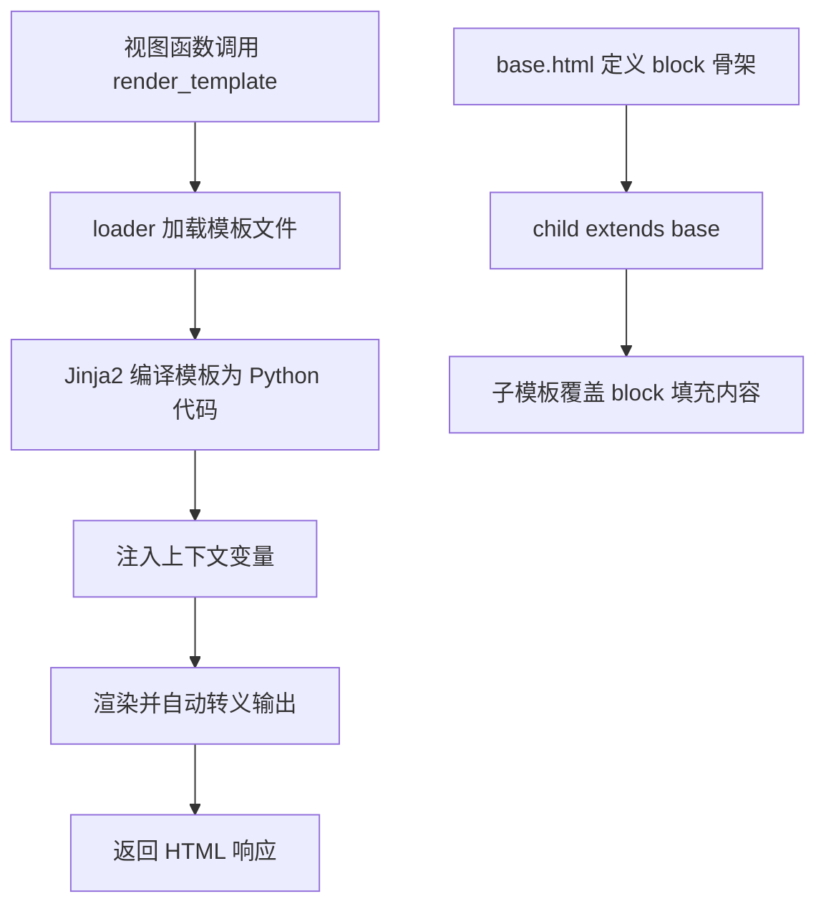

### Q121 · Jinja2 模板引擎与继承

> 难度:★★☆ | 标签:Jinja2, 模板

**问**:Jinja2 的模板继承、宏和过滤器分别解决什么问题?XSS 如何防护?

**答**:模板继承用 `` + `` 实现布局复用(子模板填充父模板的 block);`` 复用片段,`` 定义可复用组件;过滤器 `{{ value | filter }}` 处理显示格式,自定义用 `app.add_template_filter`。安全上,`{{ }}` 输出自动转义防 XSS,`| safe` 会关闭转义,只可用于可信内容;`render_template_string` 渲染用户输入的模板会造成 SSTI 漏洞,必须避免。

```python
# file: code/03_Web后端开发/q121_jinja2_render.py
try:
    from jinja2 import Environment, FileSystemLoader, select_autoescape
except ImportError:
    print("该题演示需要第三方库 jinja2:pip install jinja2(正文已讲清原理,安装后可运行)")
    raise SystemExit(0)

env = Environment(
    loader=FileSystemLoader('templates'),
    autoescape=select_autoescape(['html']),   # 自动转义防 XSS
)

base_tpl = """
<html><body>
  
</body></html>
"""

child_tpl = """


  <h1>{{ user.name }}</h1>
  <p>{{ user.bio | upper }}</p>
  {{ evil | e }}

"""

env.globals['base'] = env.from_string(base_tpl)
tmpl = env.from_string(child_tpl)
html = tmpl.render(user={'name': 'alice', 'bio': 'hello'}, evil='<script>')
print('script' not in html.lower())   # True,已转义
```

**追问**:
- SSTI 的攻击路径是什么?——`render_template_string(user_input)` 让用户输入当模板执行,可读出对象链到 `__globals__` 拿敏感数据;用户内容永远作为变量传入。
- |safe 的使用纪律?——仅限服务端可信 HTML(如渲染后的富文本经 bleach 清洗);对用户输入关转义等于开 XSS 大门。
- 模板里能调复杂逻辑吗?——能但不应:模板只做展示,业务计算放视图/服务层;filter/macro 封装展示逻辑。


