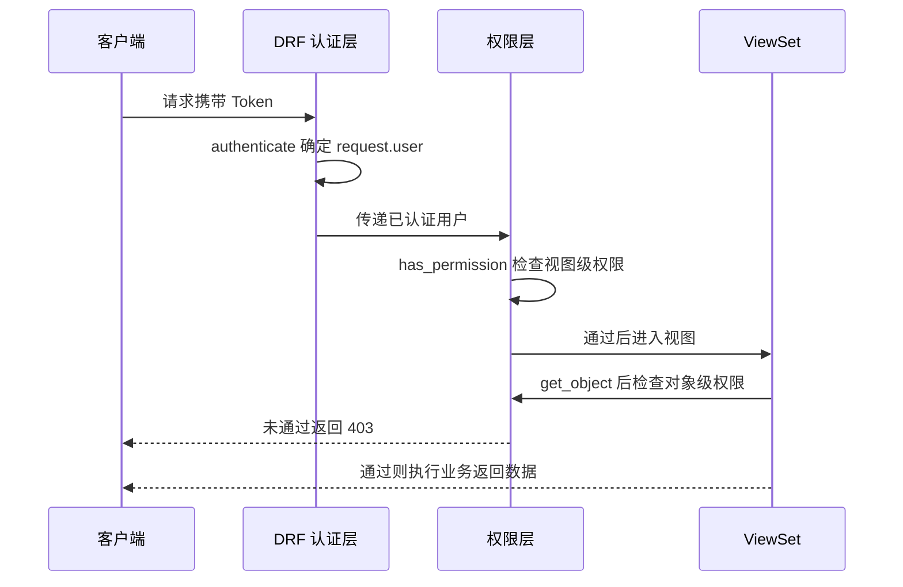

### Q131 · DRF 认证与权限体系

> 难度:★★★ | 标签:DRF, 认证, 权限

**问**:DRF 的认证和权限是两层什么关系?如何实现"登录可读、管理员可写"?

**答**:认证 Authentication 先确定 `request.user`(TokenAuthentication/JWTAuth 等,多个类按序尝试),权限 Permission 再基于该身份判断放行(`IsAuthenticated`、`IsAdminUser`、自定义 `has_permission`/`has_object_permission`);DRF 请求顺序为:认证 → 权限 → 节流 → 视图。组合方式:全局 `DEFAULT_AUTHENTICATION_CLASSES` 兜底,视图级 `authentication_classes/permission_classes` 覆盖;对象级权限在 has_object_permission 中做资源属主校验。

```python
# file: code/03_Web后端开发/q131_drf_permission.py
# Django + DRF 模块级代码
try:
    from rest_framework.permissions import BasePermission, SAFE_METHODS
    from rest_framework.authentication import TokenAuthentication
except ImportError:
    print("该题演示需要第三方库 djangorestframework:pip install djangorestframework(正文已讲清原理,安装后可运行)")
    raise SystemExit(0)

class IsAdminOrReadOnly(BasePermission):
    """安全方法放行,写操作仅管理员"""
    def has_permission(self, request, view):
        if request.method in SAFE_METHODS:
            return bool(request.user and request.user.is_authenticated)
        return bool(request.user and request.user.is_staff)

    def has_object_permission(self, request, view, obj):
        # 对象级:普通用户只能读自己创建的资源
        if request.method in SAFE_METHODS:
            return True
        return request.user.is_staff or getattr(obj, 'owner_id', None) == request.user.id

class BookViewSet:
    authentication_classes = [TokenAuthentication]
    permission_classes = [IsAdminOrReadOnly]
    # 请求流程: Token 认证确定 user -> has_permission -> get_object -> has_object_permission
```

**追问**:
- 认证和权限的执行顺序?——认证先确定身份,权限再判断放行,然后节流,最后进视图;顺序错了权限判断会拿不到 user。
- has_permission 与 has_object_permission 区别?——前者视图级(能否访问该端点),后者对象级(能否操作这条数据);对象级要显式调用 get_object 后触发。
- 多认证类的优先级?——按列表顺序尝试,第一个成功者生效;JWT 与 Session 混合部署时把 API 客户端用的放前面。


