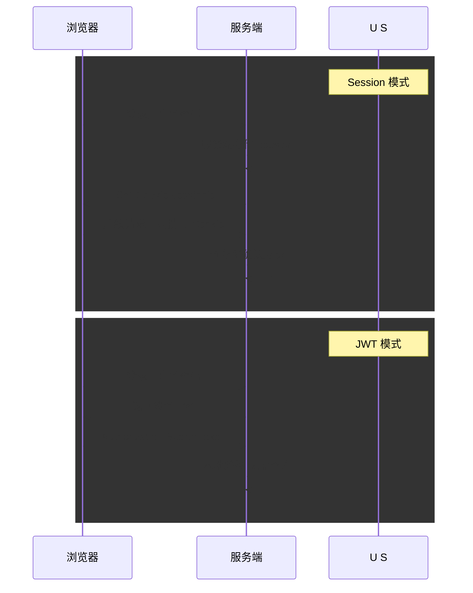

### Q132 · Session 与 JWT 认证机制对比

> 难度:★★★ | 标签:Session, JWT, 认证

**问**:Session 和 JWT 两种认证方案各自的工作流程与优缺点是什么?如何选型?

**答**:Session:登录后服务端存储会话(内存/Redis/DB),下发 `Set-Cookie: sessionid=...`,后续请求浏览器自动带 Cookie,服务端查存储确认身份;有状态、可随时踢人、安全属性可控(HttpOnly),但多实例需共享存储。JWT:无状态,签名自包含用户信息,天然适合分布式与移动端,但不可撤销、泄露即失控。选型:同源 Web 应用推荐 Session+Cookie;前后端分离/多端/网关间调用用 JWT(短过期+refresh);混合架构可 JWT 落 Redis 兼顾可撤销性。

```python
# file: code/03_Web后端开发/q132_session_jwt.py
import hmac
import base64
import json

SECRET = b'change-me'

def make_session(store: dict, user: str) -> str:
    sid = 'sess-0001'
    store[sid] = {'user': user}                 # 服务端保存状态
    return sid

def check_session(store: dict, sid: str):
    return store.get(sid, {}).get('user')       # 有状态:查存储

def b64(data: bytes) -> str:
    return base64.urlsafe_b64encode(data).rstrip(b'=').decode()

def sign_jwt(payload: dict) -> str:
    header = b64(json.dumps({'alg': 'HS256'}).encode())
    body = b64(json.dumps(payload).encode())
    sig = hmac.new(SECRET, f'{header}.{body}'.encode(), 'sha256').hexdigest()
    return f'{header}.{body}.{sig}'             # 无状态:签名即凭证

session_store: dict = {}
sid = make_session(session_store, 'alice')
token = sign_jwt({'sub': 'alice', 'exp': 4102444800})
print(check_session(session_store, sid), sign_jwt.__name__)
```

**追问**:
- JWT 在多实例下真的无状态吗?——验证签名本地即可;但一旦要撤销(登出/封号)就得引入共享黑名单,退化为半有状态。
- Session 集中存储的选型?——Redis 主流:过期自动管理、读写快;DB 存储便于审计但每次请求多一跳。
- 混合方案长什么样?——JWT 内嵌 session 版本号或 jti 落 Redis,签发快、可撤销;网关统一校验,业务服务无感。


