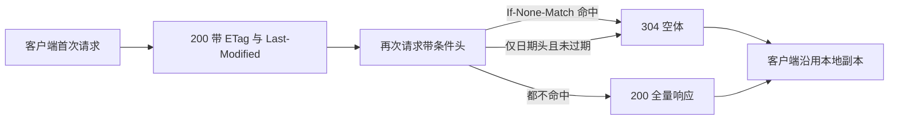

### Q1347 · Last-Modified 与 If-Modified-Since 的秒级陷阱

> 难度:★★★ | 标签:HTTP 缓存, 接口设计

**问**:用 Last-Modified 做协商缓存,为什么会出现"内容没变却总回 200"?怎么修?

**答**:HTTP 日期只有**秒级精度**,而数据库时间戳常带微秒;服务端拿完整精度的时间戳去和秒级精度的请求头比较,几乎永远判"已修改"。正确做法是双方都截断到秒再比,并且服务端生成 Last-Modified 时就用 `format_datetime(usegmt=True)` 输出 GMT 格式。另一个坑:如果一秒内资源被改了多次,Last-Modified 感知不到,这类资源应改用 ETag 或在写入时保证秒级单调。它和 If-None-Match 并存时后者优先。

```python
# file: code/03_Web后端开发/q1347_last_modified.py
"""Last-Modified 协商:秒级精度对齐后再比较(纯标准库)。"""
from datetime import datetime, timezone
from email.utils import format_datetime, parsedate_to_datetime


def not_modified_since(last_modified, if_modified_since):
    """last_modified 为 aware datetime;头缺失返回 False 表示要发全量。"""
    if not if_modified_since:
        return False
    client_seen = parsedate_to_datetime(if_modified_since)
    lm = last_modified.replace(microsecond=0)  # 截断到秒,与 HTTP 日期同精度
    return lm <= client_seen


last_modified = datetime(2026, 10, 31, 12, 0, 0, 500000, tzinfo=timezone.utc)
header = format_datetime(last_modified.replace(microsecond=0), usegmt=True)
print("Last-Modified 头:", header)
print("客户端缓存与当前一致 ->", not_modified_since(last_modified, header))
print("资源在客户端缓存之后更新过 ->", not_modified_since(last_modified, "Sat, 01 Oct 2026 00:00:00 GMT"))
print("缺头 ->", not_modified_since(last_modified, None))
```

**追问**:
- 静态文件该用哪个?——两者都给:Last-Modified 免费、ETag 精确,Nginx 对静态文件默认就是这套组合。
- 为什么必须用 GMT?——HTTP 日期规范只接受 GMT,本地时区会被解析失败或判错。


