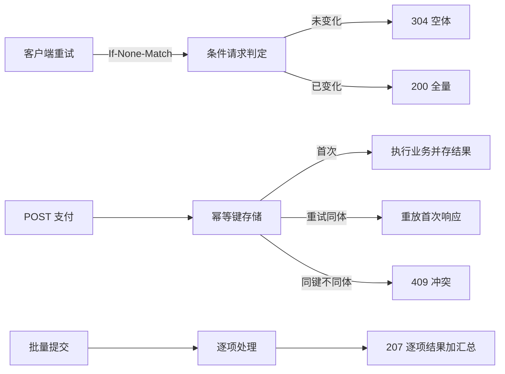

### Q1350 · 批量接口的部分成功设计

> 难度:★★★ | 标签:接口设计, 批量

**问**:批量创建 100 条数据,第 37 条失败,这个接口该怎么响应?

**答**:两种契约要提前选定:**全有或全无**(事务回滚,语义简单但一条坏数据拖垮整批)和**部分成功**(逐项处理,返回逐项结果)。选部分成功就用 207 Multi-Status 或 200 包一层逐项数组:每项带索引、业务 ID、status 与失败原因,**单项失败绝不中断其他项**,顶层附 summary(total/succeeded/failed)让调用方不用自己数。失败原因要给程序可读的 code 和人可读的 message;响应顺序必须与请求顺序一致,方便对位。

```python
# file: code/03_Web后端开发/q1350_batch_partial.py
"""批量接口部分成功:逐项结果 + 汇总统计(纯标准库,fastapi 可用时挂路由)。"""
try:
    from fastapi import FastAPI
    HAS_FASTAPI = True
except ImportError:
    HAS_FASTAPI = False
    print("[降级] 未安装 fastapi,以下用纯函数演示同一响应结构")


def process_batch(items):
    """逐项独立处理,返回 {results, summary},顺序与请求一致。"""
    results = []
    for item in items:
        try:
            if item["amount"] <= 0:
                raise ValueError("amount 必须为正数")
            results.append({"index": item["index"], "id": item["id"],
                            "status": "success", "data": {"fee": item["amount"] // 100}})
        except (KeyError, ValueError) as exc:
            results.append({"index": item.get("index"), "id": item.get("id"),
                            "status": "failed", "error": {"code": "INVALID_AMOUNT",
                                                          "message": str(exc)}})
    ok = sum(1 for r in results if r["status"] == "success")
    return {"results": results,
            "summary": {"total": len(results), "succeeded": ok, "failed": len(results) - ok}}


if HAS_FASTAPI:
    app = FastAPI()

    @app.post("/v1/fees/batch")
    def batch_route(items: list):
        return process_batch(items)
    print("[fastapi] 已注册 POST /v1/fees/batch 路由示例")

resp = process_batch([
    {"index": 0, "id": "a1", "amount": 250},
    {"index": 1, "id": "a2", "amount": -1},
    {"index": 2, "id": "a3", "amount": 80},
])
print(resp["summary"])
for r in resp["results"]:
    tail = r.get("error", {}).get("message", "ok")
    print(r["index"], r["status"], tail)
```

**追问**:
- 什么时候必须选全有或全无?——账务、库存这类要求批次原子性的场景,宁可让客户端修好数据重提。
- 批量里有依赖顺序怎么办?——按序处理并在失败项之后标记 skipped,或直接拒绝混合批次。


