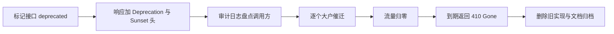

### Q1356 · 接口弃用的标准落地:Sunset 头与调用方盘点

> 难度:★★★ | 标签:弃用, 接口治理

**问**:接口要下线了,除了群里喊一嗓子,工程上应该做哪几件事?

**答**:让弃用**机器可读**:响应加 `Deprecation` 头标记弃用、`Sunset` 头(RFC 8594)给出确切下线日期、`Link rel="sunset"` 指向迁移文档;到期后路由返回 **410 Gone** 而不是 404,明确告诉调用方"曾存在、已永久移除"。同时开启**调用方盘点**:对弃用路由按 API Key / User-Agent 记审计日志,排出还没迁移的大头,逐个催迁——流量没归零之前不能硬删。版本共存与路由组织是另一道题,这里聚焦"下线动作"本身。

```python
# file: code/03_Web后端开发/q1356_sunset_audit.py
"""接口弃用:Deprecation/Sunset 头与调用方盘点(纯标准库,fastapi 可用时挂路由)。"""
from datetime import date

try:
    from fastapi import FastAPI
    HAS_FASTAPI = True
except ImportError:
    HAS_FASTAPI = False
    print("[降级] 未安装 fastapi,以下用纯函数演示同一逻辑")

ROUTES = {
    "GET /v1/orders": {"sunset": date(2026, 12, 31)},
    "GET /v2/orders": {"sunset": None},
}
audit = {}   # path -> {caller: count}


def handle(method_path, today, caller="api-key-unknown"):
    meta = ROUTES[method_path]
    headers = {}
    if meta["sunset"]:
        headers["Deprecation"] = "true"
        headers["Sunset"] = meta["sunset"].strftime("%a, %d %b %Y") + " 00:00:00 GMT"
        headers["Link"] = '<https://docs.example.com/migrate>; rel="sunset"'
        audit.setdefault(method_path, {})
        audit[method_path][caller] = audit[method_path].get(caller, 0) + 1
        if today > meta["sunset"]:
            return 410, headers
    return 200, headers


if HAS_FASTAPI:
    app = FastAPI()

    @app.get("/v1/orders")
    def orders_v1():
        status, headers = handle("GET /v1/orders", date.today())
        return status, headers
    print("[fastapi] 已注册带 Sunset 逻辑的 /v1/orders 示例路由")

print(handle("GET /v1/orders", date(2026, 11, 2)))
print(handle("GET /v1/orders", date(2027, 1, 5)))
handle("GET /v1/orders", date(2027, 1, 5), caller="partner-x")
handle("GET /v1/orders", date(2027, 1, 5), caller="partner-x")
handle("GET /v1/orders", date(2027, 1, 5), caller="mobile-app")
print("待迁移调用方排行:", sorted(audit["GET /v1/orders"].items(), key=lambda kv: -kv[1]))
```

**追问**:
- 为什么下线用 410 不用 404?——404 无法区分"从未存在"和"已弃用",410 让客户端立即停止重试并触发迁移告警。
- Sunset 到期当天直接 410 吗?——先观察一周 410 比例与调用方工单,确认无关键流量再删代码。


