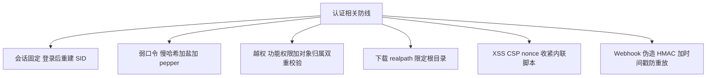

### Q1361 · Pepper:应用级密钥的第二道防线

> 难度:★★★★ | 标签:密码存储, 密钥管理

**问**:加了盐为什么还要 pepper?pepper 怎么落地?

**答**:盐只防彩虹表,**防不了拖库后的本地爆破**——盐就存在库里,和哈希一起被拖走。pepper 是一个**不存在数据库里**的应用级全局密钥,对已哈希结果再叠一层 HMAC:数据库泄露时攻击者没有 pepper,连离线爆破都无从发起,必须先攻破应用服务器才能拿到。落地要点:pepper 来自环境变量或 KMS(不进代码库)、轮换采用"新 pepper 计算、旧 pepper 验证后重哈希"的双读策略、pepper 长度至少 32 字节随机。它不替代慢哈希,是慢哈希之上的增援。

```python
# file: code/03_Web后端开发/q1361_pepper.py
"""pepper:对慢哈希结果再叠一层应用级 HMAC(纯标准库)。"""
import hashlib
import hmac
import os


def load_pepper():
    pepper = os.environ.get("APP_PEPPER")
    if not pepper:
        pepper = "demo-pepper-change-me"
        print("[降级] 未设置 APP_PEPPER,使用演示值;生产必须来自 KMS 或环境变量")
    return pepper.encode()


PEPPER = load_pepper()


def with_pepper(base_hash_hex):
    return hmac.new(PEPPER, base_hash_hex.encode(), hashlib.sha256).hexdigest()


def verify(base_hash_hex, stored):
    return hmac.compare_digest(with_pepper(base_hash_hex), stored)


base = hashlib.pbkdf2_hmac("sha256", b"pw", b"salt", 100_000).hex()
stored = with_pepper(base)
print("校验通过:", verify(base, stored))

wrong = hmac.new(b"other-pepper", base.encode(), hashlib.sha256).hexdigest()
print("pepper 不符即失败(拖库者无 pepper 时正是这种局面):", verify(base, wrong))
```

**追问**:
- pepper 泄露了怎么办?——轮换 pepper 并让用户重哈希,和密钥泄露应急同流程;影响面远小于"没有 pepper 时拖库"。
- 双 pepper 过渡期怎么验证?——存储串带上 pepper 版本号,验证时按版本选 pepper,登录成功即用新版本重哈希。


