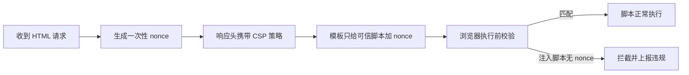

### Q1367 · CSP 内容安全策略与 nonce 方案

> 难度:★★★ | 标签:CSP, XSS

**问**:CSP 是什么?为什么生产环境推荐 nonce 而不是 allowlist 域名?

**答**:CSP 是浏览器执行的安全策略,用响应头声明"哪些来源的脚本/样式可以执行",是 **XSS 的最后一道防线**——即使注入成功,脚本也跑不起来。推荐形态:`default-src 'self'` 打底,脚本用 `script-src 'nonce-随机值' 'strict-dynamic'`,每个响应生成一次性 nonce 并只加在可信 `<script nonce>` 上,这样不需要枚举第三方域名,也杜绝了 `'unsafe-inline'`。上线策略用 `Content-Security-Policy-Report-Only` 先观察违规报告,收敛后再强制执行;`frame-ancestors 'none'`、`object-src 'none'`、`base-uri 'self'` 是常配的加固项。

```python
# file: code/03_Web后端开发/q1367_csp.py
"""CSP 头构造与 nonce 注入(纯标准库,fastapi 可用时挂中间件)。"""
import secrets

try:
    from fastapi import FastAPI, Request
    HAS_FASTAPI = True
except ImportError:
    HAS_FASTAPI = False
    print("[降级] 未安装 fastapi,以下演示头构造逻辑")


def csp_header(nonce):
    return "; ".join([
        "default-src 'self'",
        f"script-src 'self' 'nonce-{nonce}' 'strict-dynamic'",
        "style-src 'self'",
        "img-src 'self' data:",
        "object-src 'none'",
        "base-uri 'self'",
        "frame-ancestors 'none'",
    ])


if HAS_FASTAPI:
    app = FastAPI()

    @app.middleware("http")
    async def csp_middleware(request: Request, call_next):
        response = await call_next(request)
        response.headers["Content-Security-Policy"] = csp_header(secrets.token_urlsafe(16))
        return response
    print("[fastapi] 已注册 CSP 中间件示例")

nonce = secrets.token_urlsafe(16)
header = csp_header(nonce)
print(header)
assert f"nonce-{nonce}" in header and "'unsafe-inline'" not in header
print("页面脚本写法:", f'<script nonce="{nonce}">')
```

**追问**:
- 报了违规怎么办?——Report-Only 模式把 report-uri 收到的违规按来源分类,合法的补 nonce/域名,恶意的就是 XSS 线索。
- CSP 能替代输出转义吗?——不能,转义是第一道,CSP 是纵深防御,两者都要。


