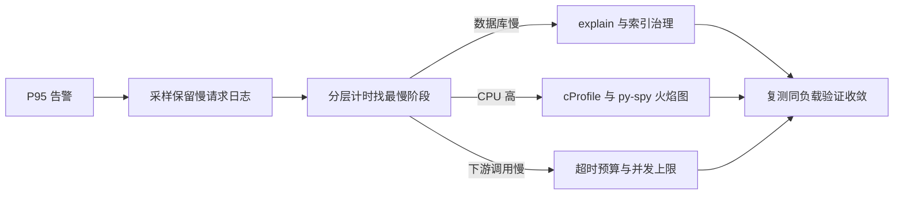

### Q1374 · 用 cProfile 定位 CPU 热点

> 难度:★★★ | 标签:性能, 剖析

**问**:确认是 CPU 阶段慢之后,怎么找到具体函数?

**答**:用标准库 `cProfile` 包住可疑代码段,按 `cumulative`(含子调用)和 `tottime`(纯自身)两个视角看:`tottime` 排最前的就是要优化或挪出热路径的函数,`cumulative` 用于确认调用链归属。注意 cProfile 有插桩开销且只能看 CPU,IO 等待要靠分层计时;输出给面试讲清楚三个数就够——ncalls(调用次数)、tottime、cumtime。定位后验证手段是改完重测同一负载,看 tottime 与总耗时同步下降,才算闭环。

```python
# file: code/03_Web后端开发/q1374_cprofile_hotspot.py
"""cProfile 热点定位(纯标准库)。"""
import cProfile
import hashlib
import io
import pstats
import random


def slow_hash(n):
    return [hashlib.sha256(str(i).encode()).hexdigest()[:8] for i in range(n)]


def slow_sort(n):
    data = [random.random() for _ in range(n)]
    data.sort()
    return len(data)


profiler = cProfile.Profile()
profiler.enable()
slow_hash(20000)
slow_sort(20000)
profiler.disable()

buf = io.StringIO()
pstats.Stats(profiler, stream=buf).sort_stats("tottime").print_stats(4)
print("\n".join(buf.getvalue().splitlines()[:14]))
```

**追问**:
- 为什么不直接在生产全程开 profile?——插桩开销可能到数倍,且输出巨大;生产用采样式 py-spy,cProfile 适合离线与压测环境。
- tottime 和 cumtime 谁先看?——先 tottime 找真凶,cumtime 用来解释它在哪条调用链上。


