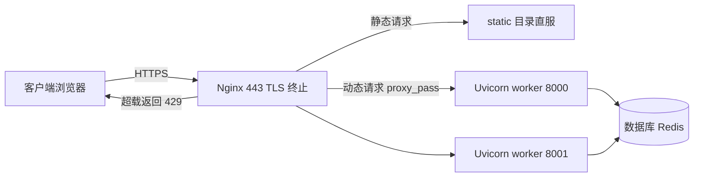

### Q138 · Nginx 反向代理配置要点

> 难度:★★☆ | 标签:Nginx, 反向代理

**问**:Nginx 在 Python Web 架构中的角色是什么?代理给 Gunicorn/Uvicorn 要注意哪些配置?

**答**:Nginx 负责 TLS 终止、静态文件直服、请求缓冲、负载均衡与限流,屏蔽后端进程细节。代理要点:`proxy_pass` 指向 upstream;必须传 `Host` 与 `X-Forwarded-For/X-Forwarded-Proto` 让应用拿到真实客户端 IP 与协议(FastAPI 中 Uvicorn 用 `--proxy-headers` + `--forwarded-allow-ip` 信任);`client_max_body_size` 放开上传限制;`proxy_read_timeout` 覆盖慢接口;WebSocket 需要 Upgrade/Connection 头,但普通请求不能带这两个头。upstream 的 `keepalive` 必须配合 `proxy_http_version 1.1`,并用 map 让普通请求的 Connection 头为空、仅 WS 请求传 upgrade,否则长连接全部失效。

```nginx
# file: code/03_Web后端开发/q138_nginx.conf
map $http_upgrade $connection_upgrade {
    default upgrade;
    ''      '';   # 普通请求不带 Connection 头,保留 upstream keepalive
}

upstream app_pool {
    server 127.0.0.1:8000;
    server 127.0.0.1:8001;
    keepalive 32;
}

server {
    listen 443 ssl;
    server_name api.example.com;

    ssl_certificate     /etc/ssl/fullchain.pem;
    ssl_certificate_key /etc/ssl/privkey.pem;

    client_max_body_size 20m;         # 匹配应用上传上限
    proxy_read_timeout 60s;

    location /static/ {
        alias /srv/myproject/staticfiles/;   # 静态文件直服
        expires 30d;
    }

    location / {
        proxy_pass http://app_pool;
        proxy_http_version 1.1;              # upstream keepalive 的前提
        proxy_set_header Host $host;
        proxy_set_header X-Real-IP $remote_addr;
        proxy_set_header X-Forwarded-For $proxy_add_x_forwarded_for;
        proxy_set_header X-Forwarded-Proto $scheme;
        proxy_set_header Upgrade $http_upgrade;      # WebSocket 支持
        proxy_set_header Connection $connection_upgrade;   # 普通请求为空,仅 WS 为 upgrade
    }
}
```

**追问**:
- 不传 X-Forwarded-For 会有什么问题?——应用把 Nginx IP 当客户端 IP,限流、审计、风控全部失效;要 `--proxy-headers` + 白名单可信代理。
- proxy_read_timeout 设多少?——大于后端最慢接口(含长轮询);SSE/WebSocket 场景要单独调 proxy_buffering off。
- 请求缓冲为什么重要?——Nginx 先收完再转后端,慢客户端不占用应用 worker;上传大文件场景反而要注意 body 过大先落地。


