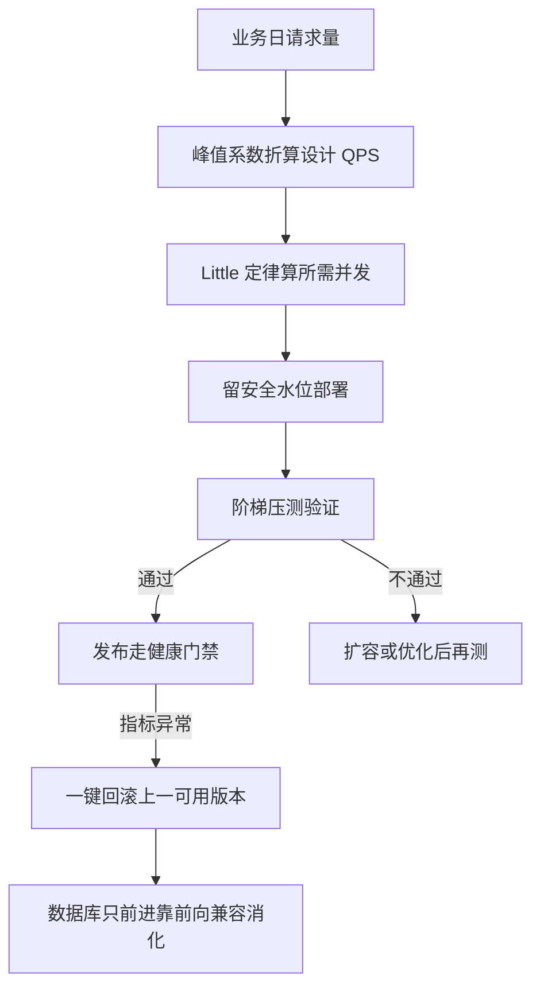

### Q1380 · 回滚的数据库边界:变更可逆性审计

> 难度:★★★★ | 标签:发布, 数据库

**问**:应用能一键回滚,数据库为什么往往回不去?发布前怎么审?

**答**:因为 schema 变更多是**破坏性不可逆**的:drop column 直接删数据、rename column 断开旧代码的列名、加 NOT NULL 无默认值会重写全表甚至失败。工程原则是**应用可回滚、数据库只前进**:发布窗口内的 DDL 全部用前向兼容形态(加列带默认、先双写后删旧列、改名走新增加同步加切换),删除动作推迟到"回滚窗口关闭之后"的清理发布。审计脚本在 CI 扫描迁移 SQL,把 drop/rename/truncate 这类操作标红拦下,逼着作者改写成两阶段。

```python
# file: code/03_Web后端开发/q1380_db_rollback.py
"""迁移 SQL 的可逆性审计:破坏性操作拦截(纯标准库演示)。"""

DESTRUCTIVE = ("drop table", "drop column", "rename column", "truncate", "delete from")


def audit_migration(sql):
    findings = []
    for i, line in enumerate(sql.splitlines(), 1):
        low = line.strip().lower()
        for op in DESTRUCTIVE:
            if low.startswith(op):
                findings.append((i, op, "不可逆:请改为前向兼容两阶段"))
        if low.startswith("add column") and "not null" in low and "default" not in low:
            findings.append((i, "add column not null", "需带默认值,否则全表重写或失败"))
    return findings


sql = """add column nickname varchar(64)
add column level int not null default 0
drop column legacy_flag
truncate table logs"""
for row in audit_migration(sql):
    print(row)
print("审计结论:有不可逆操作,禁止在回滚窗口内执行")
```

**追问**:
- 加列带默认值在大表上就安全吗?——PG 11+、MySQL 8.0 的即时加列基本安全,旧版本仍可能锁表,要看版本与表大小。
- 误删列还能救吗?——只能靠备份 PITR 恢复到独立实例再抽数据,成本极高,所以审计要在 CI 拦而不是靠恢复。


