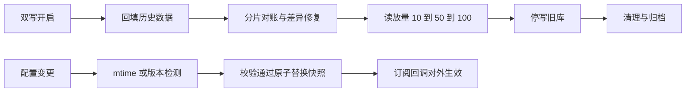

### Q1385 · 请求日志采样:保错误、去噪声

> 难度:★★★ | 标签:日志, 可观测

**问**:QPS 上万后日志存不起,怎么采样才不丢关键信息?

**答**:分层策略:**错误全采**(5xx 一条不丢,这是排障生命线)、**噪声丢弃**(404 扫描、429 限流这类高频低价值直接不记)、**成功头部采样**(按 trace_id 哈希确定性采样 1%-10%,同一 trace 命中与否全链路一致,见下一题)、**慢请求全采**(超过阈值即保留)。采样决策要前置到中间件里,而不是打完日志再过滤——省的正是序列化与 IO 成本。采样率做成配置可调,事故期间动态调高,平时回归低水位。

```python
# file: code/03_Web后端开发/q1385_log_sampling.py
"""请求日志采样:错误全采、噪声丢弃、确定性头部采样(纯标准库)。"""
import hashlib


def should_log(trace_id, status, base_rate=0.1):
    if status >= 500:
        return "keep", "error-full-sample"
    if status in (404, 429):
        return "drop", "noise-filter"
    h = int(hashlib.sha256(trace_id.encode()).hexdigest(), 16) % 10_000
    if h < base_rate * 10_000:
        return "keep", "head-sample"
    return "drop", "sampled-out"


kept = sum(1 for i in range(1000) if should_log(f"trace-{i}", 200)[0] == "keep")
print("200 请求按 10% 保留:", kept, "/1000")
print("5xx 全采:", should_log("t-x", 500))
print("404 丢弃:", should_log("t-y", 404))
print("确定性:", should_log("trace-42", 200) == should_log("trace-42", 200))
```

**追问**:
- 采样后怎么统计全量错误率?——指标(计数、直方图)不采样,只有日志与 trace 采样;两者职责分开。
- 为什么按 trace_id 而不是按请求随机?——保证同一条调用链要么全有日志要么全无,跨服务排障才完整。


