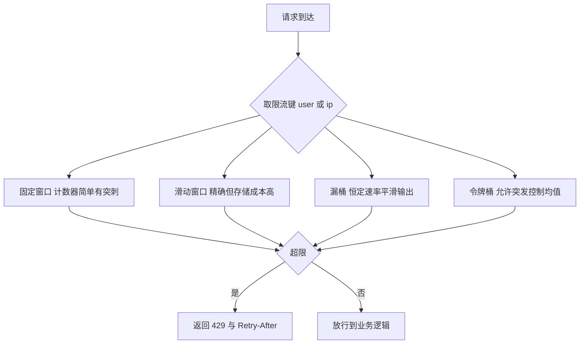

### Q139 · 限流的常见算法

> 难度:★★★ | 标签:限流, 高可用

**问**:固定窗口、滑动窗口、令牌桶、漏桶四种限流算法的区别是什么?

**答**:固定窗口计数最简单,但窗口边界处允许 2 倍突刺;滑动窗口按时间片加权统计消除突刺;漏桶以恒定速率放行,强行平滑但无法应对合理突发;令牌桶按速率生成令牌、桶有容量,允许短时突发又限制平均速率,是最常用选择。分布式场景用 Redis + Lua 保证计数原子性;限流键按 IP/用户/接口粒度选择,超出返回 429 并附 Retry-After。

```python
# file: code/03_Web后端开发/q139_rate_limit_algo.py
import time

class TokenBucket:
    """令牌桶:rate 个/秒,容量 burst 允许突发"""
    def __init__(self, rate: float, burst: int):
        self.rate = rate
        self.burst = burst
        self.tokens = float(burst)
        self.last = time.monotonic()

    def allow(self, cost: int = 1) -> bool:
        now = time.monotonic()
        self.tokens = min(self.burst, self.tokens + (now - self.last) * self.rate)
        self.last = now
        if self.tokens >= cost:
            self.tokens -= cost
            return True
        return False

class FixedWindow:
    """固定窗口:实现简单但有边界突刺"""
    def __init__(self, limit: int, window: float):
        self.limit = limit
        self.window = window
        self.count = 0
        self.start = time.monotonic()

    def allow(self) -> bool:
        now = time.monotonic()
        if now - self.start >= self.window:
            self.count, self.start = 0, now
        self.count += 1
        return self.count <= self.limit

bucket = TokenBucket(rate=5, burst=10)
print(sum(bucket.allow() for _ in range(15)))   # 前 15 次约放行 10+若秒
```

**追问**:
- Redis+Lua 为什么能保证限流原子?——计数、判断、过期在一个脚本内执行,单线程模型下不被插队;应用层两步操作有竞态。
- 限流键的粒度怎么选?——用户 > IP > 接口 组合:登录接口按 IP,业务接口按用户;按 IP 在 NAT 后会误伤。
- 429 之后客户端该做什么?——读 Retry-After 指数退避,失败进入熔断;无脑立即重试等于自我放大。


