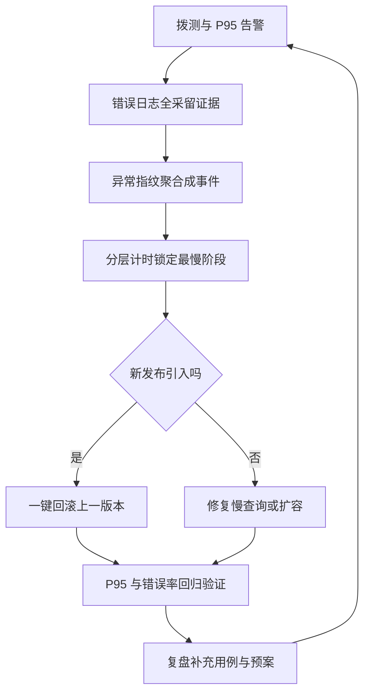

### Q1390 · 综合演练:一次慢接口事故的定位与处置

> 难度:★★★★ | 标签:综合, 故障处理

**问**:把这一节串起来:线上某接口 P95 飙升并开始出现 5xx,从发现到处置的完整链路是什么?

**答**:按闭环走六步:**发现**——拨测与 P95 告警先于人报障;**保留证据**——错误日志全采、慢请求样本带阶段计时;**定位**——按聚合指纹确认是单一异常还是多因,再按分层计时锁定最慢阶段(常是 DB);**决策**——判断是新发布引入(可回滚)还是数据量/慢查询类(需修复),优先选择可逆动作;**执行**——回滚或修复,验证 P95 与错误率回归;**复盘**——把根因变成用例进矩阵、把告警缺口补上。整条链路的每个环节都对应本节的一题:采样保证据、指纹聚事件、分层找阶段、台账助回滚。

```python
# file: code/03_Web后端开发/q1390_incident.py
"""综合演练:慢接口事故的定位与处置建议(纯标准库)。"""
import statistics

REQUESTS = [
    {"route": "/orders", "status": 200, "db": 0.9, "call": 0.1, "render": 0.05},
    {"route": "/orders", "status": 200, "db": 1.2, "call": 0.1, "render": 0.04},
    {"route": "/orders", "status": 200, "db": 2.5, "call": 0.2, "render": 0.05},
    {"route": "/orders", "status": 500, "db": 3.0, "call": 0.1, "render": 0.0},
    {"route": "/health", "status": 200, "db": 0.01, "call": 0.0, "render": 0.01},
]


def summarize(reqs):
    by_route = {}
    for r in reqs:
        by_route.setdefault(r["route"], []).append(r)
    report = {}
    for route, rows in by_route.items():
        totals = sorted(r["db"] + r["call"] + r["render"] for r in rows)
        p95 = totals[min(int(len(totals) * 0.95), len(totals) - 1)]
        err = sum(1 for r in rows if r["status"] >= 500) / len(rows)
        avg_stage = {s: statistics.mean(r[s] for r in rows) for s in ("db", "call", "render")}
        slowest = max(avg_stage, key=avg_stage.get)
        action = "回滚最近发布或治理慢查询" if (p95 > 1.0 or err > 0) else "观察"
        report[route] = {"p95_s": round(p95, 2), "error_rate": err,
                         "slowest_stage": slowest, "action": action}
    return report


for route, info in summarize(REQUESTS).items():
    print(route, info)
print("闭环:错误日志已全采 -> 指纹聚合 -> 定位 db 阶段 -> 可逆处置 -> 复盘进矩阵")
```

**追问**:
- 处置时先修数据还是先回滚?——先恢复服务(可逆动作),数据修复放事后,带着完整证据慢慢修。
- 复盘产出什么才算完成?——至少三件:根因结论与时间线、回归用例进 CI、告警或 runbook 的缺口补丁。


