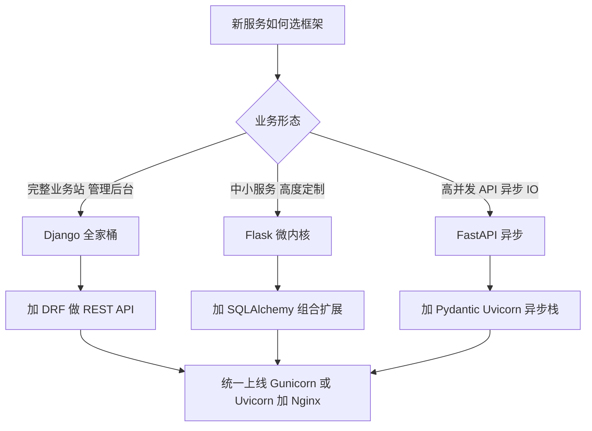

### Q145 · 框架选型:Django vs Flask vs FastAPI

> 难度:★★☆ | 标签:架构, 选型

**问**:三个主流框架如何选型?各自适用场景和组合生态是什么?

**答**:Django 是全家桶:ORM/Admin/Auth/迁移开箱即用,适合内容型、管理后台、需要快速交付完整业务的项目;Flask 微内核+扩展自由组合,适合中小服务、原型和需要高度定制的团队;FastAPI 原生异步+类型驱动校验+自动 OpenAPI 文档,适合高并发 API 网关、AI 推理服务、微服务。性能上 FastAPI/Uvicorn 在 IO 密集场景领先,但瓶颈常在数据库而非框架;选型还要看团队熟悉度与生态(如 Django+DRF 做 API、Flask+SQLAlchemy)。

```python
# file: code/03_Web后端开发/q145_framework_compare.py
DECISION = {
    'Django': {
        '适合': ['管理后台', '内容型网站', '重业务 CRUD', '团队大交付急'],
        '生态': ['Django ORM', 'DRF', 'Admin', 'Celery'],
        '风格': '全家桶 约定优于配置',
    },
    'Flask': {
        '适合': ['中小服务', '原型验证', '需要灵活定制'],
        '生态': ['SQLAlchemy', 'Flask-Login', 'Flask-Migrate'],
        '风格': '微内核 扩展自由组合',
    },
    'FastAPI': {
        '适合': ['高并发 API', '微服务', 'AI 推理服务', '需要自动文档'],
        '生态': ['Pydantic v2', 'Uvicorn', 'SQLAlchemy async', 'ARQ'],
        '风格': '异步优先 类型驱动',
    },
}

for name, info in DECISION.items():
    print(name, '->', info['风格'])
# 结论: 瓶颈多在数据库与外部 IO;先定团队与业务形态,再定框架
```

**追问**:
- 性能不是框架选型的第一因素吗?——通常不是,数据库与外部调用才是瓶颈;团队熟悉度、生态、招聘难度权重更高。
- 从 Flask 迁 FastAPI 值不值?——高并发 IO 与类型校验收益明显;存量同步代码多、团队不熟 asyncio 时收益打折。
- Django 也能做高并发 API 吗?——DRF+Django3 ASGI 可以,但每请求开销与同步默认习惯使其更适合业务复杂度高的中后台。


