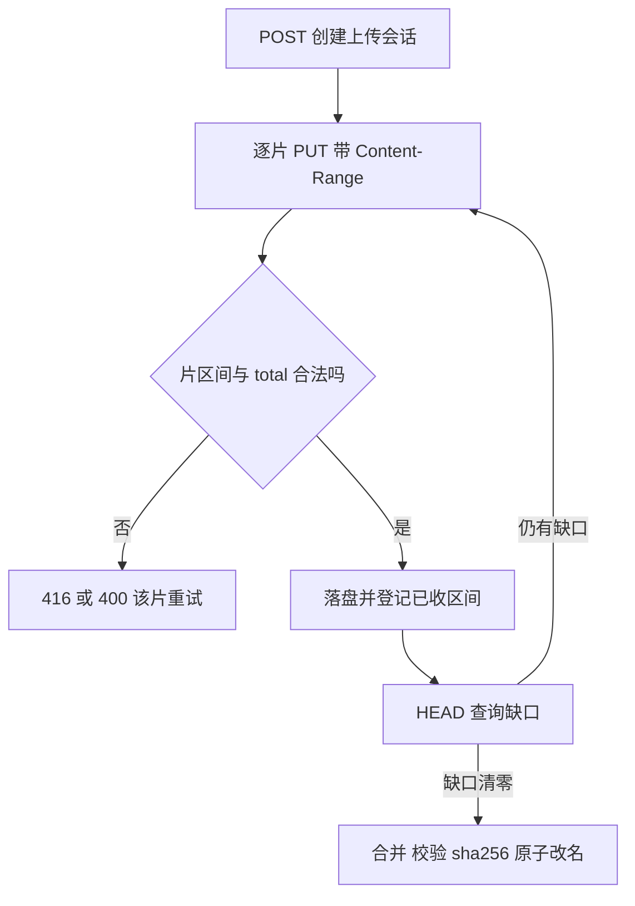

### Q1620 · 分片上传协议与断点续传

> 难度:★★★☆ | 标签:文件上传, HTTP

**问**:大文件分片上传的协议怎么设计?客户端断线重连后怎么知道还缺哪些分片?

**答**:三段式:先 POST 创建上传会话,拿到上传 URL、会话 ID 与 total;然后逐片 PUT,每片带 `Content-Range: bytes start-end/total`,服务端校验区间与 total 后落盘登记;客户端可随时 HEAD 查询进度。服务端只存已收区间列表,乱序到达没关系;缺口计算就是区间排序后扫描补洞。越界区间返回 416,total 不符返回 400,单片失败返回 5xx 让客户端只重试该片——已传部分不受影响。断线重连靠 HEAD 返回的缺口列表续传,这就是断点续传的全部秘密。

```python
# file: code/03_Web后端开发/q1620_chunk_upload_proto.py
"""Range 分片上传协议: Content-Range 登记、缺口计算与断点续传(纯标准库)。"""


class ChunkUpload:
    """服务端上传会话: 记录已落盘的闭区间列表。"""

    def __init__(self, total):
        self.total = total
        self.received = []                      # [(start, end)] 闭区间

    def put_chunk(self, content_range):
        """PUT 分片: Content-Range: bytes start-end/total。"""
        unit, rng = content_range.split()
        if unit != "bytes":
            return 400, "仅支持 bytes 单位"
        part, total = rng.split("/")
        if total != str(self.total):
            return 400, "total 与会话不符"
        start, end = (int(x) for x in part.split("-"))
        if start > end or end >= self.total:
            return 416, "区间越界"
        self.received.append((start, end))
        return 201, {"received": sorted(self.received)}

    def missing_ranges(self):
        """HEAD 查询: 已收区间之外就是缺口, 客户端按缺口补发。"""
        missing, cursor = [], 0
        for start, end in sorted(self.received):
            if start > cursor:
                missing.append((cursor, start - 1))
            cursor = max(cursor, end + 1)
        if cursor < self.total:
            missing.append((cursor, self.total - 1))
        return missing


up = ChunkUpload(1000)
print("发 0-399:", up.put_chunk("bytes 0-399/1000"))
print("乱序发 600-999:", up.put_chunk("bytes 600-999/1000"))
print("发越界片:", up.put_chunk("bytes 900-1200/1000"))
print("HEAD 查缺口:", up.missing_ranges())
print("按缺口补发 400-599:", up.put_chunk("bytes 400-599/1000")[0])
print("缺口清零:", up.missing_ranges(), "-> 可以调用合并")
```

**追问**:
- 分片大小怎么定?——常用 4-16MB,兼顾单片重试成本与请求数量,弱网调小。
- 会话要不要过期?——要,TTL 过期回收未完成会话的分片,防僵尸会话占满磁盘。


