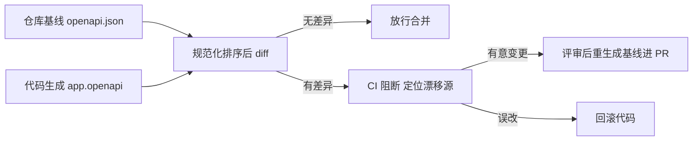

### Q1626 · OpenAPI schema 漂移检测

> 难度:★★★☆ | 标签:OpenAPI, CI

**问**:OpenAPI 文档和代码不一致,怎么在 CI 里自动发现?

**答**:漂移检测两条路:一是实现即文档——CI 里从应用生成 schema(FastAPI 是 `app.openapi()`),与仓库基线 openapi.json 做结构 diff,有差异就阻断,想更新必须显式重新生成并进 PR;二是反向校验——用基线文件生成请求去打测试环境,断言响应符合 schema,发现文档吹牛代码撒谎。diff 粒度覆盖路径、方法、请求与响应模型三层的键集合与类型。漂移检测的价值不在文档好看,而在下游按文档写的 SDK、mock、调用方校验不会悄悄失效。

```python
# file: code/03_Web后端开发/q1626_schema_drift.py
"""OpenAPI schema 漂移检测: 代码生成 vs 仓库基线(纯标准库)。"""
try:
    from fastapi import FastAPI
    HAS_FASTAPI = True
except ImportError:
    HAS_FASTAPI = False
    print("[降级] 未安装 fastapi, 以下用路由表模拟 app.openapi() 的产出")

BASELINE = {
    "paths": {
        "/v1/orders": {"get": {"model": "OrderOut"},
                       "post": {"model": "OrderOut"}},
        "/v1/orders/{id}": {"get": {"model": "OrderOut"}},
    }
}


def generate_schema(routes):
    """由路由表生成 schema(真实项目里就是 app.openapi() 的结果)。"""
    paths = {}
    for path, methods in routes:
        paths.setdefault(path, {}).update(
            {m: {"model": resp} for m, resp in methods})
    return {"paths": paths}


ROUTES = [
    ("/v1/orders", [("get", "OrderOut"), ("post", "OrderOut")]),
    ("/v1/orders/{id}", [("get", "OrderOut")]),
    # 漂移源: 有人改了代码没更新基线, 多出一个 DELETE
    ("/v1/orders/{id}", [("delete", "None")]),
]


def diff_paths(base, gen):
    drift = []
    for path in sorted(set(base) | set(gen)):
        b, g = base.get(path, {}), gen.get(path, {})
        for method in sorted(set(b) | set(g)):
            if method not in b:
                drift.append(f"+ 代码新增 {method.upper()} {path}, 基线缺失")
            elif method not in g:
                drift.append(f"- 基线存在 {method.upper()} {path}, 代码已删")
            elif b[method] != g[method]:
                drift.append(f"~ {method.upper()} {path} 定义不一致")
    return drift


generated = generate_schema(ROUTES)
drift = diff_paths(BASELINE["paths"], generated["paths"])
print("漂移项:", drift if drift else "无, 基线与实现一致")
if HAS_FASTAPI:
    print("[提示] 真实项目在 CI 里跑 app.openapi() 与 openapi.json 的 diff")
```

**追问**:
- 基线文件冲突了怎么办?——以代码生成结果为准重新生成,由评审决定是否有意变更。
- 生成结果噪音大怎么办?——先做规范化排序再比对,过滤仅顺序差异。


