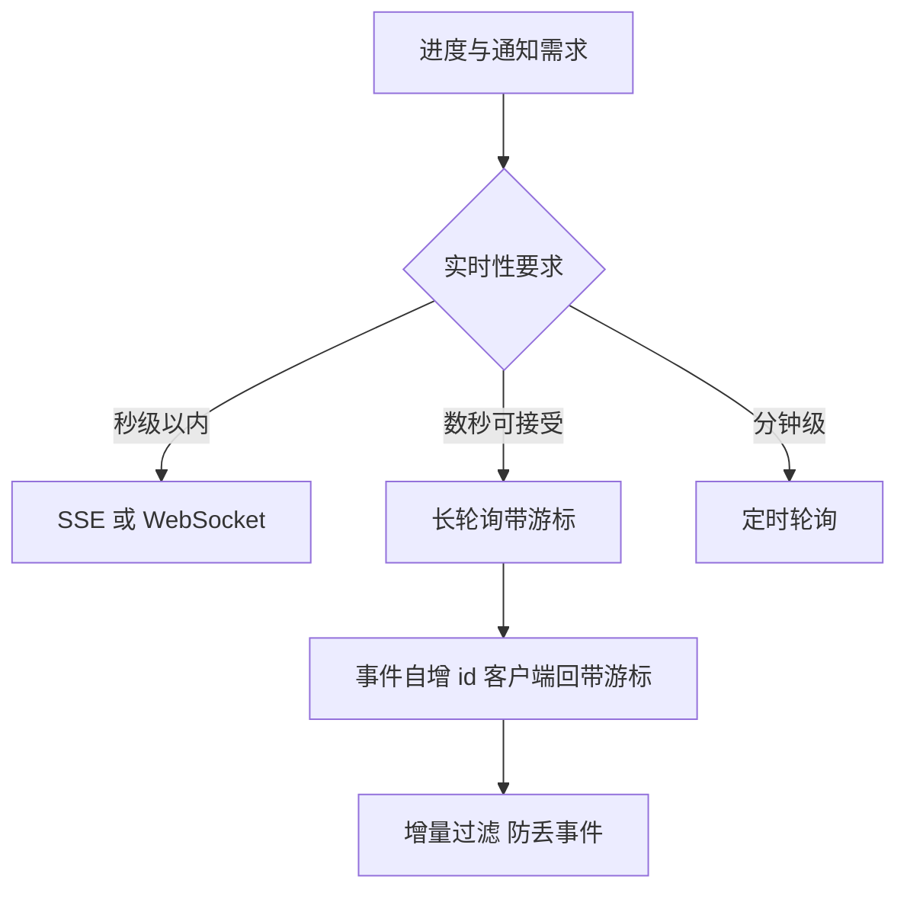

### Q1631 · 长轮询游标与丢事件竞态

> 难度:★★★★ | 标签:长轮询, 架构选型

**问**:长轮询两次请求之间发生的事件会不会丢?选型上它和 SSE、WebSocket 怎么取舍?

**答**:会丢,如果服务端实现是返回最新 N 条而不是返回 id 大于游标的事件——两次轮询之间涌入超过 N 条就必然丢。正确做法是事件日志自增 id,客户端每次带上次见过的最大 id,服务端做增量过滤并回带 next_cursor;超时返回空响应也必须带 cursor。选型边界:秒级以内实时性或服务端持续推送选 SSE 或 WebSocket;数秒延迟可接受、请求响应模型够用选长轮询;分钟级容忍直接定时轮询。长轮询实现成本低、穿透代理能力强,是够用就好场景的首选。

```python
# file: code/03_Web后端开发/q1631_long_poll_race.py
"""长轮询的丢事件竞态: 游标过滤才是正确姿势(纯标准库)。"""

EVENTS = []


def publish(text):
    EVENTS.append({"id": len(EVENTS) + 1, "text": text})


def poll(cursor, hold_has_new=False):
    """cursor 是客户端已见的最大事件 id; hold_has_new 模拟挂起期间有事件到达。"""
    new = [e for e in EVENTS if e["id"] > cursor]
    if not new and hold_has_new:
        publish("挂起期间到达")
        new = [e for e in EVENTS if e["id"] > cursor]
    return {"events": new, "next_cursor": new[-1]["id"] if new else cursor, "held": not new}


# 正常路径: 挂起期间事件到达, 长轮询立即唤醒
r1 = poll(0, hold_has_new=True)
print("挂起唤醒:", r1)

# 竞态: 两次轮询之间涌入多条事件, 取"最新一条"的坏实现会丢事件
publish("e1")
publish("e2")
publish("e3")
buggy = EVENTS[-1:]
good = [e for e in EVENTS if e["id"] > 0]
print("坏实现 latest-1 拿到:", [e["text"] for e in buggy], "丢了", len(good) - len(buggy), "条")
print("游标过滤拿到:", [e["text"] for e in good], "next_cursor:", good[-1]["id"])
print("结论: 长轮询必须传游标做增量过滤, 超时空响应也要回带 next_cursor")
```

**追问**:
- 游标被客户端伪造怎么办?——游标是不透明整数,配合鉴权与按订阅隔离,伪造最多拿到自己订阅范围内的日志。
- 事件要不要保序?——按 id 排序投递,消费端按 id 去重排序,乱序到达也能恢复。


