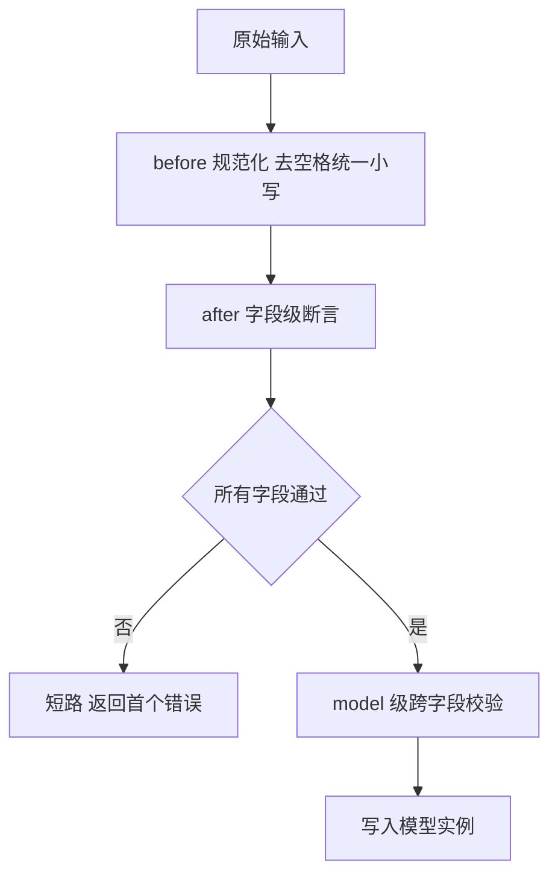

### Q1637 · 规范化先于校验的顺序实战

> 难度:★★★☆ | 标签:Pydantic, 校验

**问**:带空格大写的邮箱被格式校验拒绝了,怎么修才不是打补丁?

**答**:根因是校验器顺序错了:格式断言跑在规范化之前,看到的是脏数据。修法是把清洗逻辑挪进 mode=before 的校验器(去空格、统一小写、电话去分隔符),让 mode=after 的格式校验只面对干净数据;判断标准很直接——同一输入,规范化后能通过校验的就不该被拒。反面教材是把 strip 塞进 after 校验器里顺便做,等于清洗和断言耦合,别的字段复用时错误顺序又被复制一遍。规范化要有边界:去空格可以,静默删除非法字符不行,超出清洗能力的数据应该拒绝而不是猜用户想要什么。

```python
# file: code/03_Web后端开发/q1637_normalize_first.py
"""规范化必须先于校验: before 与 after 的顺序实战(纯标准库模拟)。"""


def wrong_order(raw):
    """坏味道: 先格式校验后规范化 -> 带空格或大写的合法输入被误拒。"""
    if "@" not in raw or " " in raw:
        return "拒绝"
    return "通过: " + raw.strip().lower()


def right_order(raw):
    """正确: mode=before 里先规范化, 格式校验看到的是干净数据。"""
    cleaned = raw.strip().lower()
    if "@" not in cleaned:
        return "拒绝"
    return "通过: " + cleaned


cases = [" A@B.COM ", "a@b.com", "not-email"]
for c in cases:
    print(repr(c), "坏顺序:", wrong_order(c), "| 好顺序:", right_order(c))

phone_raw = " 138 0000 0000 "
clean = phone_raw.strip().replace(" ", "")
print("电话规范化:", clean, "位数合法:", len(clean) == 11)
print("要点: 清洗放 before, 断言放 after; 两类逻辑混进同一个校验器最容易出隐性 bug")
```

**追问**:
- 规范化放客户端做行不行?——客户端可做体验优化,服务端必须重做,永远不能信任输入已清洗。
- 哪些字段最适合 before 清洗?——手机号、邮箱、身份证、金额全角转半角这类有明确规范形态的输入。


