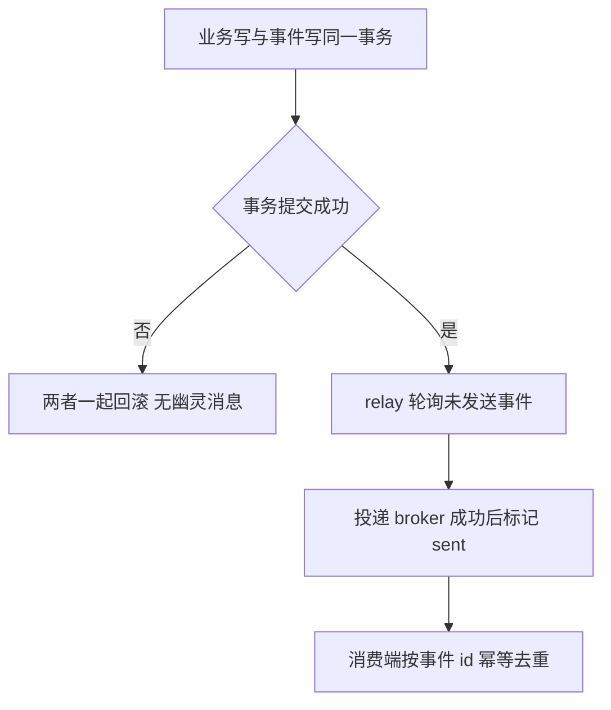

### Q1643 · 事务内发消息与 Outbox 模式

> 难度:★★★★ | 标签:消息一致性, 事务

**问**:订单创建成功但 MQ 消息没发出去,或者反过来消息发了订单回滚了,怎么办?

**答**:这是数据库事务与消息投递无法共用一个事务的经典问题,解法是事务性发件箱(Transactional Outbox):业务写入与事件写入放同一个本地事务——订单 insert 与 outbox 表 insert 一起提交或一起回滚;独立的 relay 进程轮询 outbox 未发送行,投递到 broker 成功后标记 sent。两个关键性质:投递是至少一次(relay 可能在标记前崩溃导致重发),所以消费端必须按事件 ID 幂等;relay 只做投递不做业务,业务逻辑留在事务内,幽灵消息(业务回滚但消息已发)从根上消除。直接在事务里调 broker 发消息为什么不行:消息发出后事务回滚,消息收不回来,broker 侧已经扩散。

```python
# file: code/03_Web后端开发/q1643_outbox.py
"""事务内发消息的坑与 Outbox 模式(标准库 sqlite3)。"""
import sqlite3

conn = sqlite3.connect(":memory:")
conn.executescript("""
CREATE TABLE orders (id INTEGER PRIMARY KEY, status TEXT);
CREATE TABLE outbox (id INTEGER PRIMARY KEY AUTOINCREMENT, event TEXT, sent INT DEFAULT 0);
""")


def place_order(status="paid"):
    """正确: 业务写与事件写放同一个事务, 提交后由 relay 投递。"""
    with conn:
        conn.execute("INSERT INTO orders (status) VALUES (?)", (status,))
        conn.execute("INSERT INTO outbox (event) VALUES (?)", (f"order.{status}",))
    return conn.execute("SELECT MAX(id) FROM outbox").fetchone()[0]


def relay():
    """投递中继: 只读未发送事件, 发送成功才置位; 至少一次投递 + 消费端幂等。"""
    rows = conn.execute("SELECT id, event FROM outbox WHERE sent = 0").fetchall()
    sent = []
    for oid, event in rows:
        sent.append(event)                       # 此处假装调用 broker
        conn.execute("UPDATE outbox SET sent = 1 WHERE id = ?", (oid,))
    conn.commit()
    return sent


place_order()
print("下单后 outbox:", conn.execute("SELECT id, event, sent FROM outbox").fetchall())
print("relay 投递:", relay())
print("投递后 outbox:", conn.execute("SELECT id, event, sent FROM outbox").fetchall())


def place_order_rollback():
    """反例: 业务失败回滚, 但事务内直接发的消息不会跟着回滚。"""
    ghost = []
    try:
        with conn:
            conn.execute("INSERT INTO orders (status) VALUES ('bad')")
            ghost.append("order.bad")            # 事务内直接调 broker 的效果
            raise RuntimeError("下游约束失败")
    except RuntimeError as e:
        print("回滚原因:", e)
    return ghost


ghost = place_order_rollback()
print("幽灵消息(业务回滚但消息已发):", ghost)
print("outbox 模式下 orders 行数:", conn.execute("SELECT COUNT(*) FROM orders").fetchone()[0])
```

**追问**:
- relay 轮询延迟怎么压?——提交后额外触发一次即时拉取,轮询兜底;或用 CDC 监听 outbox 表变更。
- outbox 表会无限涨吗?——不会,已发送且过保留期的行归档清理,注意清理别和 relay 抢锁。


