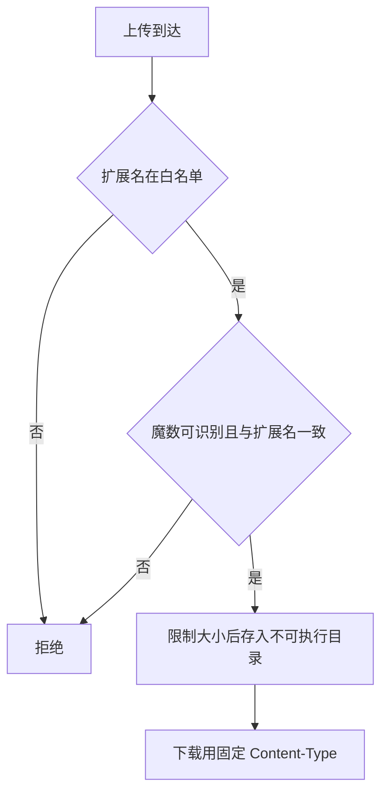

### Q1649 · 魔数加扩展名的双校验

> 难度:★★★☆ | 标签:文件上传, 安全

**问**:上传文件的魔数加扩展名双校验怎么落地?双校验通过就绝对安全吗?

**答**:落地两步:先扩展名白名单,不在名单直接拒,把 png、jpg 之外的全部挡掉;再读文件头比对魔数(PNG 的 89 50 4E 47、JPEG 的 FF D8 FF、PDF 的 %PDF-、ZIP 的 PK 头),魔数不认识或与扩展名不一致都拒绝——改名伪装的文件在这一步现形。魔数取前几字节即可,注意 ZIP 系(docx、xlsx、apk)共用 PK 头,要按业务拆分白名单而不是都当 zip 放行。双校验不是终点:多合 polyglot 文件同时满足两种魔数、图片内嵌恶意元数据,还要靠存储目录不可执行、下载固定 Content-Type、图片重编码兜底;大小限制与病毒扫描按业务叠加。

```python
# file: code/03_Web后端开发/q1649_magic_bytes.py
"""魔数白名单 + 扩展名白名单的双校验落地(纯标准库)。"""

MAGIC = [
    (b"\x89PNG\r\n\x1a\n", "png"),
    (b"\xff\xd8\xff", "jpg"),
    (b"%PDF-", "pdf"),
    (b"PK\x03\x04", "zip"),
]
EXT_WHITELIST = {"png", "jpg"}


def sniff(data):
    for magic, kind in MAGIC:
        if data.startswith(magic):
            return kind
    return None


def accept(filename, data):
    ext = filename.rsplit(".", 1)[-1].lower() if "." in filename else ""
    if ext not in EXT_WHITELIST:
        return False, f"扩展名 {ext or '缺失'} 不在白名单"
    kind = sniff(data)
    if kind is None:
        return False, "魔数不认识, 拒绝"
    if ext != kind:
        return False, f"扩展名 {ext} 与魔数 {kind} 不一致"
    return True, f"{kind} 双校验通过"


samples = [
    ("a.png", b"\x89PNG\r\n\x1a\n" + b"x" * 10),
    ("b.jpg", b"\xff\xd8\xff" + b"y" * 10),
    ("c.png", b"PK\x03\x04" + b"z" * 10),          # zip 改名 png
    ("d.svg", b"<svg xmlns='x'>"),                  # 扩展名不在白名单
    ("e.png", b"GIF89a" + b"w" * 10),               # GIF 冒充 png
]
for name, data in samples:
    ok, why = accept(name, data)
    print(f"{name}: {'收' if ok else '拒'} - {why}")
print("要点: 双校验只看文件头仍不完美, 多合 polyglot 文件要靠存储隔离与固定 Content-Type 兜底")
```

**追问**:
- 大文件验魔数要先全量读吗?——不用,魔数只读头部几 KB,流式处理边读边验。
- SVG 为什么常被单独禁?——SVG 是 XML 可携带 script,是存储型 XSS 高发区,净化掉 script 与事件属性前不放行。


