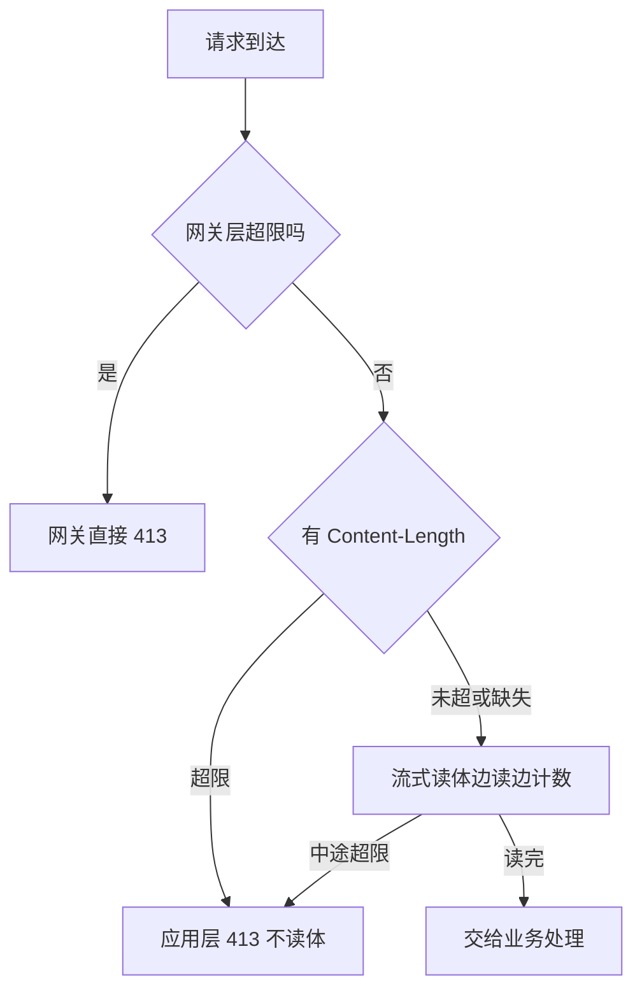

### Q1654 · 请求体大小限制两层防线

> 难度:★★☆☆ | 标签:请求体, 限流

**问**:请求体大小限制应该在哪几层做?应用层怎么在读体之前就拒绝?

**答**:分层设防:网关层的 client_max_body_size 是第一道,超限在应用进程外就被 413,保护最彻底;应用层是最后防线,防网关被绕过或配置漏掉。应用层两步:有 Content-Length 的请求先看头,超限直接 413,一个字节都不读——便宜且确定;chunked 或无长度声明时,流式读体边读边计数,一超限立刻掐断连接,不给慢速 POST 用小内存换长连接的机会。两个细节:Content-Length 非数字要 400 而不是当 0 放过;413 要规范响应,避免客户端还在写体导致连接 RST 噪声。限制阈值按业务分级:JSON 接口 MB 级,上传接口单独放行。

```python
# file: code/03_Web后端开发/q1654_body_limit.py
"""请求体大小限制: Content-Length 前置检查 + 流式计数兜底(纯标准库)。"""

MAX_BODY = 1024 * 1024                       # 1 MiB


class PayloadTooLarge(Exception):
    pass


def precheck(headers):
    """读体之前先看 Content-Length, 超限直接拒绝, 一个字节都不收。"""
    raw = headers.get("Content-Length")
    if raw is None:
        return None
    try:
        length = int(raw)
    except ValueError:
        return 400
    return 413 if length > MAX_BODY else None


def read_with_limit(chunks):
    """chunked 无长度场景: 边读边数, 一超限立刻掐断, 不给慢速攻击喂内存。"""
    total = 0
    for chunk in chunks:
        total += len(chunk)
        if total > MAX_BODY:
            raise PayloadTooLarge(f"流式读超过 {MAX_BODY}B")
        yield chunk


print("CL=2MiB  ->", precheck({"Content-Length": str(2 * 1024 * 1024)}))
print("CL=64KiB ->", precheck({"Content-Length": "65536"}), "(放行)")
print("CL=abc   ->", precheck({"Content-Length": "abc"}))

chunks = [b"x" * (512 * 1024)] * 3           # 共 1.5 MiB, 无 Content-Length
try:
    for _ in read_with_limit(chunks):
        pass
except PayloadTooLarge as e:
    print("流式拦下:", e)
print("要点: 应用层限额是最后防线, 网关层 client_max_body_size 是第一道, 两层都要有")
```

**追问**:
- 413 和 400 什么时候用哪个?——大小超限 413,头部格式非法 400,语义别混用。
- 为什么不能读进内存再检查?——读进来时内存已经被吃了,限制的意义就是不让这一步发生。


