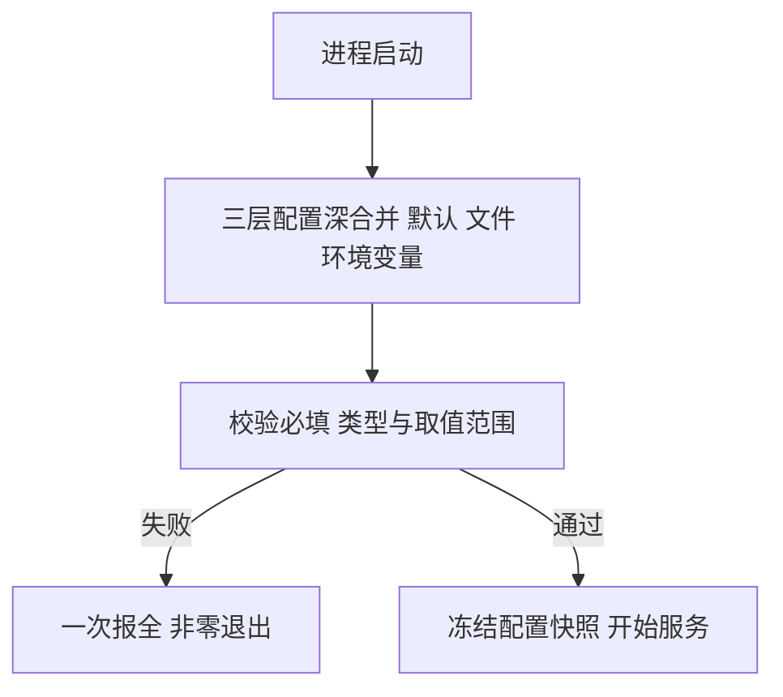

### Q1659 · 配置启动校验 fail-fast

> 难度:★★☆☆ | 标签:配置管理, fail-fast

**问**:配置错了为什么要在启动时就崩?启动校验应该检查哪些内容?

**答**:fail-fast 的理由:配置错误越晚暴露定位越贵——启动期报 secret_key 必填是一眼可见的报错,首个请求时抛 500 是线上事故加一场排查;而且带病启动会污染依赖它的所有请求。启动校验四类:必填项存在;类型正确(端口是 1-65535 的整数、workers 是正整数);取值合法(db_url 协议受支持、secret_key 非默认值);引用可解析(文件路径存在、下游地址可连通)。工程要求:一次校验报出全部错误而不是逐个试错,省发布来回;报错信息写清哪个键、期望什么、实际什么;校验通过后冻结配置快照,运行期只读——启动校验是配置的最后一道门,不是锦上添花。

```python
# file: code/03_Web后端开发/q1659_config_validate.py
"""配置启动校验: 缺什么一次报全, fail-fast 拒绝带病启动(纯标准库)。"""


class ConfigError(Exception):
    pass


REQUIRED = ("db_url", "port", "workers", "secret_key")


def validate(cfg):
    errors = []
    for key in REQUIRED:
        if key not in cfg:
            errors.append(f"{key} 必填")
    db_url = cfg.get("db_url", "")
    if db_url and not db_url.startswith(("postgres://", "mysql://", "sqlite://")):
        errors.append("db_url 协议不受支持")
    try:
        port = int(cfg["port"])
        if not 1 <= port <= 65535:
            errors.append(f"port 超出 1-65535: {port}")
    except (KeyError, ValueError, TypeError):
        errors.append("port 必须是 1-65535 的整数")
    workers = cfg.get("workers")
    if not isinstance(workers, int) or workers < 1:
        errors.append(f"workers 必须是 >= 1 的整数, 当前 {workers!r}")
    secret = cfg.get("secret_key", "")
    if secret in ("", "changeme", "secret"):
        errors.append("secret_key 不能为空或使用默认值")
    if errors:
        raise ConfigError("配置校验失败:\n  - " + "\n  - ".join(errors))
    return {"db_url": db_url, "port": port, "workers": workers}


bad = {"db_url": "ftp://x", "port": "80800", "workers": 0, "secret_key": "changeme"}
try:
    validate(bad)
except ConfigError as e:
    print("坏配置一次报全:")
    print(e)

good = {"db_url": "postgres://db/app", "port": "8000", "workers": 4, "secret_key": "from-vault"}
print("修复后启动:", validate(good))
print("要点: 校验放启动期而不是首个请求期; 一次报全所有错误, 省去逐个试错的发布来回")
```

**追问**:
- 校验失败进程退出码给多少?——非零,编排系统据此重启并告警,绝不能吞错继续起服务。
- 下游连通性检查会不会拖慢启动?——设短超时并允许延迟校验,首个使用时再验;结构性错误必须启动期拦下。


