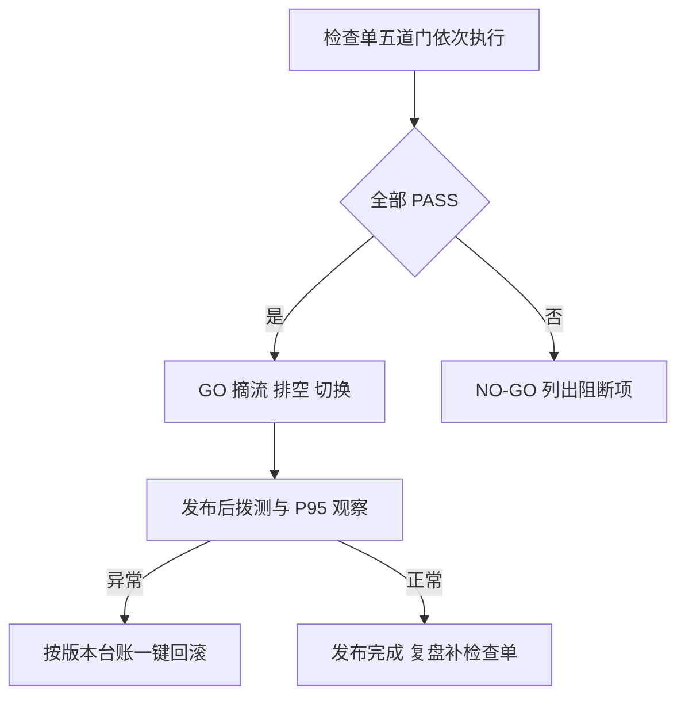

### Q1660 · 发布检查单引擎与 go/no-go

> 难度:★★★★ | 标签:发布, 综合设计

**问**:把这个专题的发布要素串起来:一次夜间发布的 go/no-go 检查单应该包含哪些门?

**答**:五道门对应五类事故源头:自动化测试门(单元加契约快照,防接口行为回退)、配置校验门(启动校验,防带病启动)、迁移可逆门(变更必须两阶段可回退,删列这类不可逆动作拆成加新列、迁移、删旧列)、排空演练门(摘流排空脚本演练过,防发布掉线)、回滚预案门(回滚脚本与版本台账就绪,防出事退不回去)。执行方式机器化:每道门是返回 PASS 或 FAIL 加证据的函数,检查单引擎汇总,全部 PASS 才 GO,任一 FAIL 列出阻断项——宁可延期,不带病上线。发布后还要闭环:拨测与 P95 观察,异常按台账一键回滚,复盘补检查单。

```python
# file: code/03_Web后端开发/q1660_release_checklist.py
"""收官综合: 发布检查单引擎, 全绿才 GO(纯标准库)。"""

FIX_MIGRATION = False


def gate_tests():
    return True, "单元与契约测试全绿"


def gate_config():
    return True, "配置校验通过, secret 来自 vault"


def gate_migration():
    if FIX_MIGRATION:
        return True, "迁移改为加列两阶段, 可随时回退"
    return False, "迁移含删列, 未做两阶段发布"


def gate_drain():
    return True, "readiness 摘流与排空已演练"


def gate_rollback():
    return True, "回滚脚本与版本台账就绪"


GATES = [("自动化测试", gate_tests), ("配置校验", gate_config),
         ("迁移可逆", gate_migration), ("排空演练", gate_drain),
         ("回滚预案", gate_rollback)]


def release():
    results = [(name, fn()) for name, fn in GATES]
    blockers = [name for name, (ok, _) in results if not ok]
    print("--- 发布检查单 ---")
    for name, (ok, note) in results:
        print(f"{'PASS' if ok else 'FAIL'}  {name}: {note}")
    print("决策:", "GO" if not blockers else f"NO-GO 阻断项: {', '.join(blockers)}")
    print()


print("第一轮:")
release()
FIX_MIGRATION = True
print("修复迁移后第二轮:")
release()
print("要点: 检查单把人脑记忆变成机器门禁, 任一项 FAIL 就 NO-GO, 宁可延期不可带病上线")
```

**追问**:
- 检查单会不会越加越长拖慢发布?——按变更类型裁剪:纯配置变更不跑迁移门;门禁自动化后单次全量检查应在分钟级。
- 紧急修复也要全门吗?——保留测试与回滚两道硬门,其余可豁免但必须记录豁免人与理由,事后补审。


