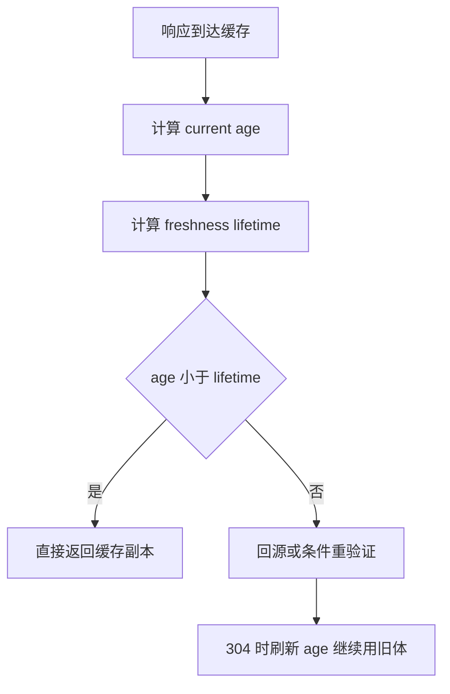

### Q1890 · Date 与缓存新鲜度的计算

> 难度:★★★☆ | 标签:HTTP 缓存, RFC 7234

**问**:缓存判断"还新不新鲜"到底怎么算?Age 头为什么会越滚越大?

**答**:本质是两个量比较:新鲜度生命周期 freshness_lifetime 与已老化秒数 current_age。生命周期按优先级取值:s-max-age、max-age、Expires 减 Date 的差值,都没有时用启发式——Date 减 Last-Modified 的 10%。current_age 的计算要把链路老化叠加:apparent_age 是响应到达时间与 Date 的差,与 Age 头取较大者,再加请求耗时修正与本地驻留时间;中间每过一跳老化都在累积,这就是 Age 越滚越大的原因。age 小于 lifetime 即新鲜,直接命中;不新鲜则回源或带 If-None-Match 条件重验证,304 命中时只刷新 age 不重传体。还要分清 s-maxage 与 no-cache:前者管共享缓存的时长,后者强制每次重验证,语义完全不同。

```python
# file: code/03_Web后端开发/q1890_freshness.py
"""HTTP 缓存新鲜度: Date/Age 与新鲜度生命周期的计算(纯标准库)。"""
from email.utils import parsedate_to_datetime


def parse_http_date(s):
    return parsedate_to_datetime(s).timestamp()


def freshness_lifetime(resp, now=None):
    """按 RFC 7234 计算新鲜度生命周期(秒)。

    优先级: s-max-age > max-age > Expires-Date 差值 > 启发式 10% 的 Date-Last-Modified。
    """
    cc = resp.get("cache-control", "")
    directives = dict(d.split("=", 1) if "=" in d else (d, None)
                      for d in cc.split(",") if d.strip())
    if "s-maxage" in directives:
        return int(directives["s-maxage"])
    if "max-age" in directives:
        return int(directives["max-age"])
    if "expires" in resp and "date" in resp:
        return max(0, int(parse_http_date(resp["expires"]) - parse_http_date(resp["date"])))
    if "date" in resp and "last-modified" in resp:
        age_hint = parse_http_date(resp["date"]) - parse_http_date(resp["last-modified"])
        return max(0, int(age_hint * 0.10))    # 启发式: 存活时长的 10%
    return 0


def current_age(resp, request_time, response_time, now):
    """计算响应在缓存中已经"老"了多少秒, Age 头与本地时钟差都要算进去。"""
    date_v = parse_http_date(resp["date"]) if "date" in resp else response_time
    apparent_age = max(0, int(response_time - date_v))
    age_hdr = int(resp.get("age", "0"))
    corrected_received = max(apparent_age, age_hdr)
    response_delay = response_time - request_time
    corrected_initial = corrected_received + int(response_delay)
    resident = int(now - response_time)
    return corrected_initial + resident


def verdict(resp, request_time, response_time, now):
    age = current_age(resp, request_time, response_time, now)
    life = freshness_lifetime(resp)
    return age, life, age < life


base = {"date": "Mon, 02 Nov 2026 08:00:00 GMT"}
t = parse_http_date(base["date"])
# 情形一: max-age 60, 链路上 Age 10, 本地驻留 20 -> 仍新鲜
resp1 = dict(base, **{"cache-control": "max-age=60", "age": "10"})
age, life, fresh = verdict(resp1, t, t + 2, t + 22)
print("max-age=60 Age=10 驻留20 -> 已老 {}s 生命周期 {}s 新鲜 {}".format(age, life, fresh))
assert fresh
# 情形二: 无 max-age, 用 Expires-Date 差值
resp2 = dict(base, **{"expires": "Mon, 02 Nov 2026 08:00:30 GMT"})
print("Expires 差值 ->", freshness_lifetime(resp2), "s")
# 情形三: 无显式指令, 启发式 10% 的存活时长
resp3 = dict(base, **{"last-modified": "Mon, 02 Nov 2026 06:00:00 GMT"})
print("启发式(2小时存活的10%) ->", freshness_lifetime(resp3), "s")
# 情形四: 老化到超期 -> 不新鲜, 必须回源或带条件重验证
age, life, fresh = verdict(resp1, t, t + 2, t + 95)
print("老化到 95s 时 -> 新鲜 {}".format(fresh))
assert not fresh
print("要点: 新鲜度判定是 current_age 与 freshness_lifetime 的比较, Age 头会把中间链路的老化叠加进来")
```

**追问**:
- 启发式 10% 是谁定的?——RFC 7234 的建议值,站点完全不写缓存头时的兜底行为。
- Age 超过 max-age 就是坏响应吗?——不是,只是不新鲜,条件重验证拿到 304 后仍可继续用。


