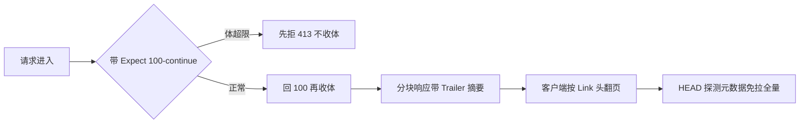

### Q1895 · HEAD 请求的语义与元数据端点

> 难度:★★★☆ | 标签:HTTP, API 设计

**问**:HEAD 和 GET 的区别只是不返回体吗?工程上哪里会用到?

**答**:HEAD 要求返回与 GET 完全相同的头(含 Content-Length、ETag、Last-Modified)但不携带体,实现上通常由 GET 处理器推导:跑同样的逻辑,丢弃体、保留头。工程价值三点:探测大对象大小再决定是否下载;配 If-None-Match/If-Modified-Since 做无体的缓存校验;CDN 与代理用它续期而不消耗回源带宽。坑点:头不一致会让客户端按错误长度预分配或误判可缓存性,要用测试锁住"GET 与 HEAD 的头完全一致";HEAD 请求同样要计入访问日志与限流,否则探测接口会被滥用绕过计费;Content-Length 描述的是 GET 的体长而 HEAD 自身体长为零,这正是它的语义。方法不存在时返回 405 并带 Allow: GET, HEAD。

```python
# file: code/03_Web后端开发/q1895_head_metadata.py
"""HEAD 请求语义: 与 GET 同头不同体(纯标准库)。"""


def get_handler(path):
    """GET 处理器: 返回 (status, headers, body)。"""
    if path == "/reports/2026":
        body = "月度报表的完整内容, 共约 8MB" * 10
        return 200, {"Content-Type": "text/plain; charset=utf-8",
                     "Content-Length": str(len(body.encode("utf-8"))),
                     "Last-Modified": "Mon, 02 Nov 2026 00:00:00 GMT"}, body
    return 404, {"Content-Type": "text/plain"}, "not found"


def dispatch(method, path):
    status, headers, body = get_handler(path)
    if method == "GET":
        return status, headers, body
    if method == "HEAD":
        # HEAD 由 GET 处理器推导: 头全保留, 体丢弃; Content-Length 仍描述 GET 的体
        return status, headers, b""
    return 405, {"Allow": "GET, HEAD"}, "method not allowed"


for method in ("GET", "HEAD"):
    status, headers, body = dispatch(method, "/reports/2026")
    body_bytes = len(body.encode("utf-8")) if isinstance(body, str) else len(body)
    print("{} /reports/2026 -> {} Content-Length={} 体字节={}".format(
        method, status, headers["Content-Length"], body_bytes))
    assert body_bytes in (0, int(headers["Content-Length"]))

status, _, body = dispatch("HEAD", "/nope")
print("HEAD 不存在的资源 -> {} 体大小 {}".format(status, len(body)))
status, headers, _ = dispatch("DELETE", "/reports/2026")
print("DELETE -> {} Allow={}".format(status, headers["Allow"]))

# HEAD 的工程意义: 探测大对象大小 / 校验 ETag / CDN 续期, 都不必拉全量
_, h1, _ = dispatch("GET", "/reports/2026")
_, h2, _ = dispatch("HEAD", "/reports/2026")
print("GET 与 HEAD 的头完全一致:", h1 == h2)
assert h1 == h2
print("要点: HEAD 的头必须与 GET 一致, 差异会让客户端按错误的长度预分配或误判可缓存性")
```

**追问**:
- HEAD 的响应也会被缓存吗?——会,与 GET 同键存头,命中后直接回头,但要确保 Vary 与缓存策略一致。
- DELETE 这类方法需要对应 HEAD 吗?——不需要,HEAD 只与 GET 绑定,其它方法的元数据查询没有标准形态。


