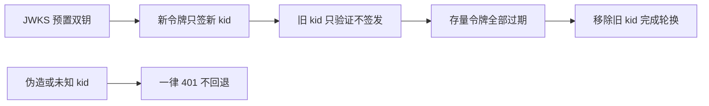

### Q1906 · JWT kid 与签名密钥轮换

> 难度:★★★☆ | 标签:JWT, 安全

**问**:JWT 签名密钥要换,怎么做到不停机?kid 头在这里起什么作用?

**答**:kid(key id)是 JWT header 里的密钥标识,验证端按它从 JWKS 多钥集合里挑对应钥匙验签。轮换三阶段:预置——JWKS 同时挂新旧两把钥匙,新令牌只签新 kid,旧 kid 进入只验证不签发;并存——存量令牌继续用旧 kid 验签直到 exp 自然过期,新请求拿到的都是新 kid;移除——旧令牌全部过期后从 JWKS 删除旧钥。安全底线:未知 kid 一律 401,绝不能回退到默认密钥,否则攻击者伪造 kid 就能绕开指定密钥;kid 值要限长限字符防注入;分布式场景 JWKS 通过 URL 拉取并缓存,缓存过期窗口决定轮换生效延迟,配合 401 引导客户端重取。RS256 时 JWKS 直接发布公钥,机制相同。

```python
# file: code/03_Web后端开发/q1906_jwt_kid.py
"""JWT kid 与签名密钥轮换: JWKS 多钥并存与未知 kid 的处理(纯标准库)。"""
import base64
import hashlib
import hmac
import json


def b64url(data):
    if isinstance(data, dict):
        data = json.dumps(data, separators=(",", ":")).encode()
    return base64.urlsafe_b64encode(data).rstrip(b"=").decode()


def b64url_decode(s):
    return base64.urlsafe_b64decode(s + "=" * (-len(s) % 4))


def sign(payload, key, kid):
    header = {"alg": "HS256", "kid": kid}
    h, p = b64url(header), b64url(payload)
    sig = hmac.new(key, (h + "." + p).encode(), hashlib.sha256).digest()
    return h + "." + p + "." + b64url(sig)


# JWKS: 验证端持有多个密钥, kid 指明用哪一把; 只有 active 的能签新令牌
JWKS = {
    "k1": {"secret": b"secret-key-v1", "state": "retiring"},
    "k2": {"secret": b"secret-key-v2", "state": "active"},
}
ACTIVE_KID = "k2"


def verify(token):
    try:
        h64, p64, s64 = token.split(".")
        header = json.loads(b64url_decode(h64))
        key_rec = JWKS.get(header.get("kid"))
        if key_rec is None:
            return 401, "未知 kid: 可能是伪造头或过期下线的密钥"
        expect = hmac.new(key_rec["secret"], (h64 + "." + p64).encode(),
                          hashlib.sha256).digest()
        if not hmac.compare_digest(expect, b64url_decode(s64)):
            return 401, "签名不匹配"
        return 200, json.loads(b64url_decode(p64))
    except Exception as e:
        return 401, "malformed: " + str(e)


old_token = sign({"sub": "u1", "v": 1}, JWKS["k1"]["secret"], "k1")
new_token = sign({"sub": "u2", "v": 2}, JWKS["k2"]["secret"], ACTIVE_KID)
print("旧钥令牌 k1 ->", verify(old_token))
print("新钥令牌 k2 ->", verify(new_token))
assert verify(old_token)[0] == 200 and verify(new_token)[0] == 200

forged = sign({"sub": "attacker"}, JWKS["k2"]["secret"], "k9")
print("未知 kid 伪造 ->", verify(forged)[0], verify(forged)[1])
assert verify(forged)[0] == 401

print("轮换节奏: 先让 JWKS 出现双钥, 新令牌只签 active kid, 旧 kid 只验证不签发, 全量过期后移除")
print("要点: kid 让验证端在不停机的前提下多钥并存, 未知 kid 直接 401, 绝不能回退到默认密钥")
```

**追问**:
- 为什么不直接同时拿两把钥匙挨个试?——能验通但浪费且模糊,kid 是确定性寻址,还便于审计哪把密钥签的。
- 怎么发现某个 kid 泄露?——监控签名失败率与单 kid 流量突增,确认后立即从 JWKS 移除该 kid 使相关令牌失效。


