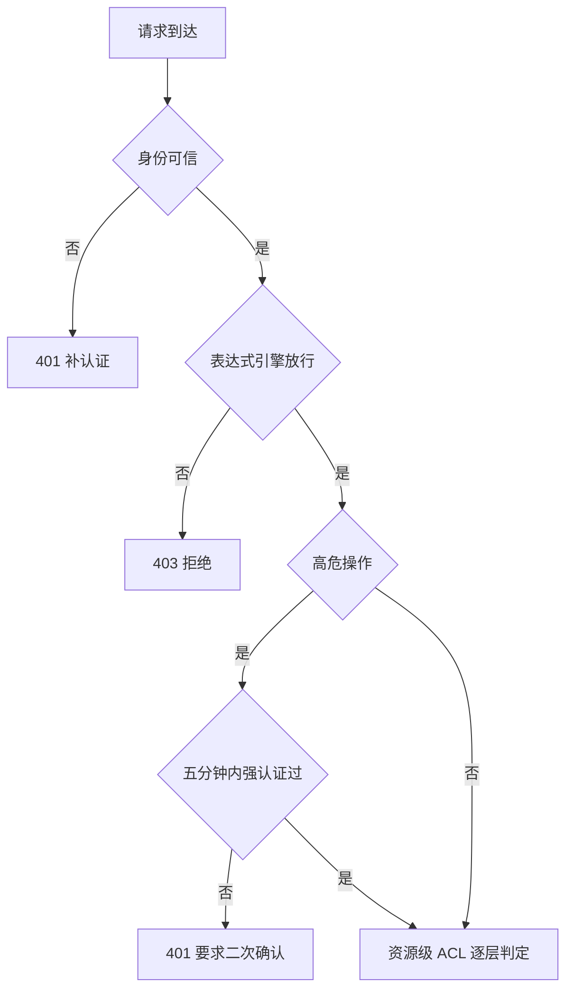

### Q1912 · 敏感操作的二次确认与最近认证窗口

> 难度:★★★★ | 标签:安全, 用户体验

**问**:转账、改绑手机这类操作,怎么避免每次都要求重新登录又保证安全?

**答**:窗口型 step-up 认证:高危操作要求"最近 N 分钟内做过强认证"(OTP、二次密码),低危操作不受影响。实现按会话记录最近强认证时间戳,高危请求检查窗口:窗口内放行,窗口外返回 401 并带 WWW-Authenticate: Reauth 引导客户端补认证,认证通过刷新时间戳;同一会话内窗口共享,避免连环操作反复打断。窗口长度按风险分级:支付类 5 到 15 分钟,管理类操作更短甚至每次确认。配套要求:强认证必须区分等级,普通登录密码不进窗口;审计记录每次高危操作距上次强认证的时长。这是安全与体验的解耦点:默认安全、频繁操作者流畅,而攻击者即使拿到会话,动钱前也要补一道认证。

```python
# file: code/03_Web后端开发/q1912_step_up.py
"""敏感操作的二次确认: 最近强认证窗口(纯标准库)。"""
import time


class StepUpGate:
    """高危操作要求 N 分钟内做过强认证(如二次密码/OTP), 否则要求先补认证。

    低危操作不受影响; 认证通过即刷新窗口时间戳。
    """

    def __init__(self, window_seconds=300):
        self.window = window_seconds
        self.strong_auth_at = {}      # session_id -> last strong auth ts

    def authenticate(self, session_id, now, method="otp"):
        if method != "otp":
            return False, "弱认证不进入窗口"
        self.strong_auth_at[session_id] = now
        return True, "强认证完成"

    def allow(self, session_id, risk, now):
        """返回 (allowed, status, www_authenticate)。"""
        if risk == "low":
            return True, 200, None
        last = self.strong_auth_at.get(session_id, 0)
        if now - last <= self.window:
            return True, 200, None
        return False, 401, "Reauth realm=high-risk, prompt=login"


gate = StepUpGate(window_seconds=300)
t0 = 1762050000.0
gate.authenticate("sess-1", t0)
print("刚认证完执行转账:", gate.allow("sess-1", "high", t0 + 60)[0:2])
assert gate.allow("sess-1", "high", t0 + 60)[0]

ok, status, www = gate.allow("sess-1", "high", t0 + 301)
print("10 分钟后执行转账 ->", status, "要求头:", www)
assert not ok and status == 401 and "Reauth" in www

ok, msg = gate.authenticate("sess-1", t0 + 310)
ok2, status2, _ = gate.allow("sess-1", "high", t0 + 320)
print("补认证后重试 ->", status2)
assert ok2
ok3, _, _ = gate.allow("sess-1", "low", t0 + 400)
print("低危浏览类操作始终放行:", ok3)
assert ok3
print("要点: 窗口型二次确认把安全与体验解耦, 高危动作点名单独要求, 响应带 WWW-Authenticate 引导客户端")
```

**追问**:
- 窗口内会话被劫持怎么办?——窗口机制防的是误操作,防劫持靠 MFA 与设备绑定,高危另配二次因子。
- 为什么用 401 而不是 403?——401 引导补认证后可重试同一请求;403 表示没有权限,补认证也没用。


