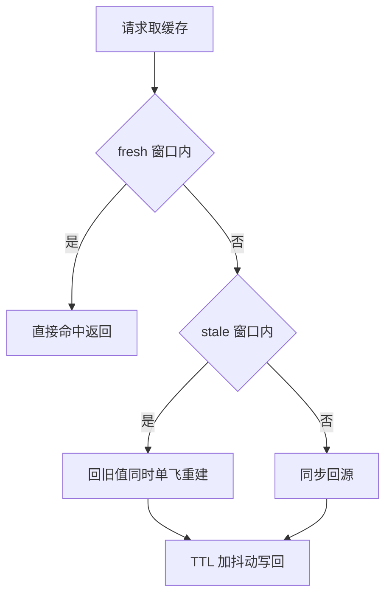

### Q1917 · 热点缓存的 TTL 抖动与 stale-while-revalidate

> 难度:★★★☆ | 标签:缓存, 稳定性

**问**:大促时一批缓存同时过期,数据库瞬间被打挂,怎么设计缓存过期?

**答**:两个机制配合。TTL 抖动:在基础 TTL 上加正负 20% 的随机偏移,同一批写入的键不再同刻过期,回源洪峰被摊平,这是防雪崩的第一刀。stale-while-revalidate:过期后不立即阻塞回源,先回旧值同时触发异步重建,旧值继续服务一个 stale 窗口,回源成本被移出请求路径;重建用单飞锁保证同一时刻只有一个线程回源,拿不到锁的线程直接用旧值返回。实现要点:条目存 fresh_until 与 stale_until 两个时刻;指标区分命中类型(fresh、stale、rebuilt),stale 占比升高说明重建跟不上消费。抖动与 SWR 解决常态过期风暴,缓存服务重启全空的极端场景还要配预热与空值保护,分层设防。

```python
# file: code/03_Web后端开发/q1917_swr_cache.py
"""热点缓存的 TTL 抖动与 stale-while-revalidate(纯标准库)。"""
import random
import threading


class SWRCache:
    """两级过期: fresh_until 内直接命中, fresh 到 stale 之间回旧值并单飞重建。

    TTL 加抖动避免同批键同时过期造成回源风暴; 重建锁保证同一时刻只有一个线程回源。
    """

    def __init__(self, loader, base_ttl=60, jitter_ratio=0.2, stale_window=120,
                 clock=None):
        self.loader = loader
        self.base_ttl = base_ttl
        self.jitter_ratio = jitter_ratio
        self.stale_window = stale_window
        self.now = clock or (lambda: 0.0)
        self.entries = {}
        self.lock = threading.Lock()

    def _ttl(self):
        jitter = random.uniform(-self.jitter_ratio, self.jitter_ratio)
        return self.base_ttl * (1.0 + jitter)

    def get(self, key):
        now = self.now()
        entry = self.entries.get(key)
        if entry and now < entry["fresh_until"]:
            return entry["value"], "fresh"
        if entry and now < entry["stale_until"]:
            self._refresh_async(key)                 # 回旧值, 同时触发重建
            return entry["value"], "stale-while-revalidate"
        value = self.loader(key)                     # 完全过期, 同步重建
        self._store(key, value, now)
        return value, "rebuilt"

    def _store(self, key, value, now):
        ttl = self._ttl()
        self.entries[key] = {"value": value,
                             "fresh_until": now + ttl,
                             "stale_until": now + ttl + self.stale_window}

    def _refresh_async(self, key):
        """用非阻塞锁实现单飞: 拿不到锁的线程直接用旧值返回。"""
        if self.lock.acquire(blocking=False):
            try:
                value = self.loader(key)
                self._store(key, value, self.now())
            finally:
                self.lock.release()


random.seed(7)
clock = {"t": 0.0}
load_count = {"n": 0}


def load(key):
    load_count["n"] += 1
    return "hot-value-v1"


cache = SWRCache(load, base_ttl=60, stale_window=120, clock=lambda: clock["t"])
v, m = cache.get("hot")
print("首次获取:", m, v, "回源次数", load_count["n"])
assert m == "rebuilt"

v, m = cache.get("hot")
print("TTL 内获取:", m)
assert m == "fresh"

clock["t"] = 70                       # 越过 fresh, 落在 stale 窗口
v, m = cache.get("hot")
print("过期瞬间获取:", m, "值为", v, "回源次数", load_count["n"])
assert m == "stale-while-revalidate" and v == "hot-value-v1"

clock["t"] = 400                     # 连 stale 窗口也过了
v, m = cache.get("hot")
print("stale 窗口外:", m)
assert m == "rebuilt"

ttls = [round(SWRCache(load, base_ttl=100, clock=lambda: 0)._ttl(), 1) for _ in range(5)]
print("抖动后的 TTL 样本:", ttls, "(同批键不再同刻过期)")
print("要点: 抖动打散过期时刻, stale 窗口把回源从请求路径上摘掉, 单飞锁防重复回源")
```

**追问**:
- SWR 会不会一直返回旧数据?——stale 窗口有上界,重建失败可告警,关键数据缩短 stale 窗口或禁用 SWR。
- 抖动比例多大合适?——20% 起步,键量越大可越小,目标是把回源峰值压到平均吞吐以下。


