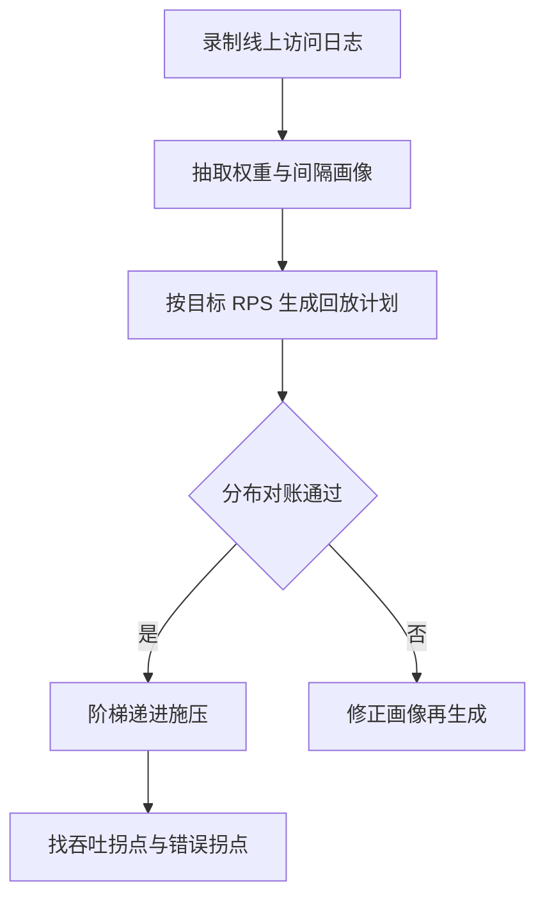

### Q1921 · 压测回放: 从录制流量生成回放计划

> 难度:★★★★★ | 标签:压测, 容量

**问**:压测流量怎么来的?拍脑袋的均匀压测为什么测不出真实问题?

**答**:真实流量有形状:路径权重分布(少数接口占大头)、到达间隔的突发性(泊松近似而非固定间隔)、参数分布(热点 id 集中)。均匀压测把这三样全抹平,瓶颈点根本不在被测位置。回放法从线上录制访问日志抽取三样生成画像,再按目标 RPS 与画像生成回放计划:时刻按指数分布抽样,路径按权重抽样。验收必须做分布对账:回放计划里各路径占比与录制画像的偏差控制在容忍带内,否则压的是另一个系统。工程细节:回放请求带独立标识(header 或专用账号)便于隔离统计与紧急熔断;敏感字段脱敏后再回放;递进施压按阶梯 RPS 找拐点而不是一步到顶。与合成压测的分工:回放保真用于生产环境与容量评估,合成灵活用于新接口与异常场景构造。

```python
# file: code/03_Web后端开发/q1921_load_replay.py
"""压测回放: 从录制流量生成回放计划(纯标准库)。"""
import json
import random

# 录制的访问日志样本: 时间戳(秒) 方法 路径 状态
RECORDED = [
    [0.00, "GET", "/api/items?page=1", 200],
    [0.12, "GET", "/api/items/42", 200],
    [0.20, "POST", "/api/orders", 201],
    [0.35, "GET", "/api/items?page=1", 200],
    [0.50, "GET", "/api/orders/7", 200],
    [0.55, "PATCH", "/api/orders/7", 200],
    [0.90, "GET", "/api/items?page=2", 200],
    [1.40, "GET", "/api/items/42", 200],
    [1.55, "POST", "/api/orders", 201],
    [2.00, "GET", "/api/items?page=1", 200],
]


def extract_profile(records):
    """按权重归并相似请求, 记录到达间隔分布, 生成回放画像。"""
    weights = {}
    gaps = []
    for i, (_, method, path, _) in enumerate(records):
        key = method + " " + path.split("?")[0]
        weights[key] = weights.get(key, 0) + 1
        if i:
            gaps.append(records[i][0] - records[i - 1][0])
    total = sum(weights.values())
    return {"weights": {k: v / float(total) for k, v in weights.items()},
            "mean_gap": sum(gaps) / len(gaps),
            "duration": records[-1][0]}


def plan_replay(profile, target_rps, duration_s, seed=42):
    """按画像权重生成回放计划: 请求时刻按泊松近似, 路径按权重抽样。"""
    rng = random.Random(seed)
    plan = []
    t = 0.0
    while t < duration_s:
        t += max(0.01, rng.expovariate(target_rps))
        if t >= duration_s:
            break
        keys = list(profile["weights"])
        path = rng.choices(keys, weights=[profile["weights"][k] for k in keys])[0]
        plan.append((round(t, 3), path))
    return plan


profile = extract_profile(RECORDED)
print("画像: 平均间隔 %.2fs 权重:" % profile["mean_gap"],
      {k: round(v, 2) for k, v in profile["weights"].items()})

plan = plan_replay(profile, target_rps=50, duration_s=2.0, seed=42)
print("回放计划(前 8 条):", plan[:8])
assert all(isinstance(t, float) and " " in p for t, p in plan)
assert len(plan) >= 80, "50 RPS 跑 2 秒应接近 100 个请求"

# 权重对账: 回放计划的分布应与录制画像一致
from collections import Counter
counts = Counter(p for _, p in plan)
for key in profile["weights"]:
    share = counts.get(key, 0) / float(len(plan))
    assert abs(share - profile["weights"][key]) < 0.15, (key, share)
print("分布对账通过: 每个路径的回放占比与录制画像偏差小于 15%")
print("要点: 回放的价值是流量形状保真, 权重与间隔都来自线上录制, 而不是拍脑袋的均匀压测")
```

**追问**:
- 回放会不会污染生产数据?——写接口改读、走影子表或按回放 id 标记后异步丢弃,环境隔离优先于一切优化。
- 录制样本多大才够?——覆盖全部路径类型且权重稳定,高峰期几分钟到几十分钟,低频路径人工补录。


