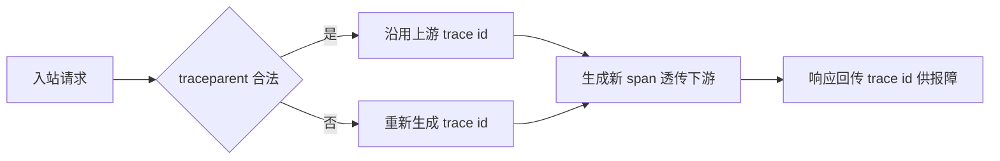

### Q1923 · trace 透传: 服务端解析 traceparent 与响应回传

> 难度:★★★☆ | 标签:链路追踪, W3C

**问**:服务端收到 traceparent 头,标准处理流程是什么?非法头怎么办?

**答**:W3C Trace Context 的 traceparent 是 version-traceid-spanid-flags 四段十六进制。服务端入口三步:解析校验(版本 00、id 非全零、长度合规);合法则沿用上游 trace id、生成自己的 span id,采样标志继承上游;非法或缺失则重新生成 trace id,采样决策由入口服务作出。兜底链要留:没带 traceparent 但带了 X-Request-ID 时,至少把请求 id 串起来,两者都缺才全新生成——完全丢掉用户侧可关联信息是最差体验。下游透传:构造新的 traceparent(同 trace id、新 span id、采样位)加 X-Request-ID 一并发。响应回传是工程加分项:X-Request-ID 与 X-Trace-Id 写回响应头,用户报障贴一个 id 就能全链路定位。错误处理原则:解析失败不抛错,降级为新生成,追踪永远不能破坏业务。

```python
# file: code/03_Web后端开发/q1923_trace_server.py
"""trace 透传: 服务端解析 traceparent 与响应回传(纯标准库)。"""
import random
import re

TRACEPARENT = re.compile(r"^([0-9a-f]{2})-([0-9a-f]{32})-([0-9a-f]{16})-([0-9a-f]{2})$")


def parse_traceparent(value):
    """按 W3C 规则校验 traceparent; 非法即视为无追踪上下文。

    version 00, trace_id/span_id 非全零, flags 1 字节: 最低位是 sampled。
    """
    if not value:
        return None, "缺失"
    m = TRACEPARENT.match(value)
    if not m:
        return None, "格式非法"
    version, trace_id, span_id, flags = m.groups()
    if version != "00":
        return None, "不支持的版本"
    if trace_id == "0" * 32 or span_id == "0" * 16:
        return None, "全零 id 无效"
    return {"trace_id": trace_id, "span_id": span_id,
            "sampled": bool(int(flags, 16) & 1)}, "ok"


def handle_inbound(headers, request_id_counter):
    """服务端入口三步: 解析 -> 兜底 -> 决定上下文与响应头。

    兜底链: traceparent 非法时回退 X-Request-ID 生成新 trace; 响应必须回传 id。
    """
    tp, why = parse_traceparent(headers.get("traceparent"))
    if tp:
        trace_id = tp["trace_id"]
        sampled = tp["sampled"]
    else:
        trace_id = "%032x" % random.getrandbits(128)
        sampled = True                       # 采样决策由入口服务作出
    request_id = headers.get("x-request-id") or "req-%d" % request_id_counter
    downstream = {
        "traceparent": "00-{}-{:016x}-{:02x}".format(
            trace_id, random.getrandbits(64), 0x01 if sampled else 0x00),
        "x-request-id": request_id,
    }
    response_headers = {"X-Request-ID": request_id, "X-Trace-Id": trace_id}
    return trace_id, downstream, response_headers, why


random.seed(9)
cases = [
    ({"traceparent": "00-4bf92f3577b34da6a3ce929d0e0e4736-00f067aa0ba902b7-01"}, 1),
    ({"traceparent": "ff-bad"}, 2),
    ({"traceparent": "00-" + "0" * 32 + "-" + "0" * 16 + "-00"}, 3),
    ({"x-request-id": "req-from-lb-7"}, 4),
]
for headers, counter in cases:
    trace_id, downstream, resp, why = handle_inbound(headers, counter)
    print("入站 {} -> 原因[{}] trace={:.12s} 下游头 traceparent={} 响应回传 X-Trace-Id={}".format(
        list(headers.values())[0][:36], why, trace_id,
        downstream["traceparent"][:24] + "...", resp["X-Trace-Id"][:12] + "..."))

tp, why = parse_traceparent("ff-bad")
assert tp is None
good, why = parse_traceparent("00-4bf92f3577b34da6a3ce929d0e0e4736-00f067aa0ba902b7-01")
assert good["sampled"] is True
print("要点: 非法 traceparent 不抛错而是重新开始一段追踪, 响应回传 id 让用户报障能一键定位")
```

**追问**:
- sampled 位每跳都能改吗?——基于父采样位决策,不可随意翻转,才能保证同一 trace 全链路一致保留。
- 请求 id 与 trace id 为什么要两个?——请求 id 面向用户报障(短、稳定),trace id 面向系统诊断(规范、可拼接)。


