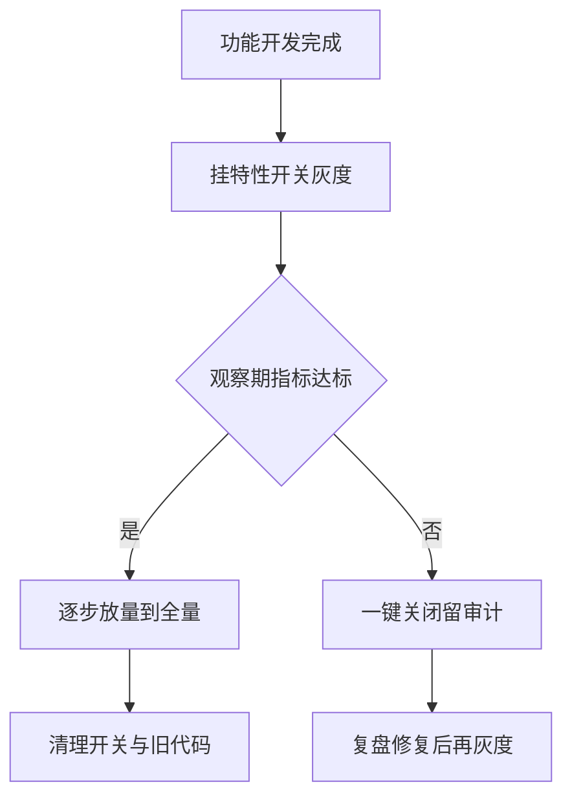

### Q1930 · 特性开关: 按用户放量与一键降级

> 难度:★★★★★ | 标签:发布, 可用性

**问**:特性开关怎么设计才能既是发布工具又是救命开关?

**答**:开关四要素:总闸 enabled、放量 rollout 百分比、白名单 allow、稳定分组。稳定分组是核心:对 user_id 做加盐哈希取模得到 0 到 99 的桶,同一用户永远落在同一桶,体验一致且结果可回放;放量按白名单、1%、10%、50%、100% 阶梯推进,每档观察错误率与业务指标。一键降级(kill switch):出问题不回滚代码,只翻总闸,秒级生效,是降级的最后手段;灰度用于渐进、kill 用于止血,两者语义互斥。治理约束三条:开关必须留审计——谁改的、为什么、何时回滚;开关有寿命,全量后限期清理,防止开关森林让代码路径不可测;测试覆盖开关组合矩阵,关键开关默认 fail-safe,依赖缺失时自动关闭。

```python
# file: code/03_Web后端开发/q1930_feature_flags.py
"""特性开关: 按用户放量、稳定分组与一键降级(纯标准库)。"""
import hashlib
import json


def bucket_of(user_id, salt="checkout-2026"):
    """对 user_id 做稳定哈希取 0-99 的桶; 同一用户永远落在同一桶。"""
    digest = hashlib.sha256((salt + ":" + user_id).encode()).hexdigest()
    return int(digest[:8], 16) % 100


class FlagRegistry:
    """特性开关注册表: enabled 总闸、rollout 百分比、allow 白名单与审计。"""

    def __init__(self, flags):
        self.flags = flags
        self.audit = []

    def enabled_for(self, name, user_id):
        flag = self.flags.get(name)
        if flag is None:
            return False, "flag 不存在"
        if not flag["enabled"]:
            return False, "总闸关闭"
        if user_id in flag["allow"]:
            return True, "白名单"
        bucket = bucket_of(user_id, flag.get("salt", name))
        if bucket < flag["rollout"]:
            return True, "灰度桶 {} 小于 {}".format(bucket, flag["rollout"])
        return False, "灰度桶 {} 未命中".format(bucket)

    def set_enabled(self, name, value, operator, reason):
        """一键降级: kill switch 只翻总闸, 改动进审计留痕。"""
        old = self.flags[name]["enabled"]
        self.flags[name]["enabled"] = value
        self.audit.append({"flag": name, "from": old, "to": value,
                           "op": operator, "reason": reason})

    def set_rollout(self, name, percent, operator):
        old = self.flags[name]["rollout"]
        self.flags[name]["rollout"] = percent
        self.audit.append({"flag": name, "rollout": "{}->{}".format(old, percent),
                           "op": operator})


flags = FlagRegistry({
    "new-checkout": {"enabled": True, "rollout": 30, "allow": ["qa-bot"],
                     "salt": "checkout-2026"},
})
u1, u2 = "user-alice", "user-bob"
print("alice:", flags.enabled_for("new-checkout", u1))
print("bob:  ", flags.enabled_for("new-checkout", u2))
r1 = flags.enabled_for("new-checkout", u1)
assert flags.enabled_for("new-checkout", u1) == r1, "同一用户结果必须稳定"

flags.set_rollout("new-checkout", 50, "pm@x")
buckets = [bucket_of("user-%d" % i, "checkout-2026") for i in range(1000)]
hit = sum(1 for b in buckets if b < 50)
print("放量 50 后千人命中率: {:.0%}".format(hit / 1000.0))
assert 0.40 < hit / 1000.0 < 0.60

flags.set_enabled("new-checkout", False, "oncall@ops", "下单转化率骤降")
print("一键降级后 alice:", flags.enabled_for("new-checkout", u1))
assert flags.enabled_for("new-checkout", u1)[0] is False
print("审计:", json.dumps(flags.audit, ensure_ascii=False)[:120], "...")
print("要点: 开关把发布与功能解耦, 稳定哈希保证体验一致, kill switch 是降级的最后手段且必须留痕")
```

**追问**:
- 开关与配置中心什么关系?——开关是带语义与生命周期的配置,复用配置通道但要独立审计与看板。
- 多实例怎么保证放量一致?——哈希分组是无状态的,各实例独立计算结果一致,不需要分布式协调。


