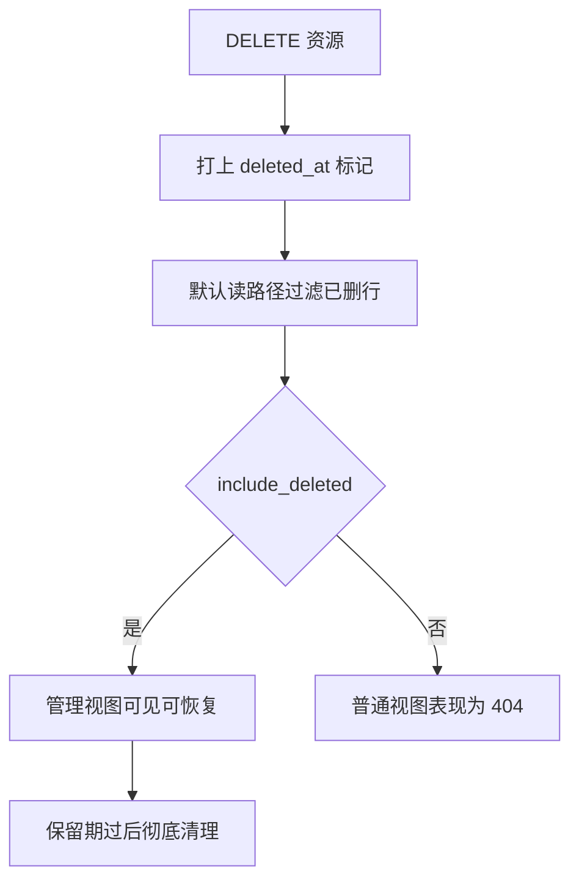

### Q2161 · 软删除端点语义

> 难度:★★☆☆ | 标签:REST, 数据建模

**问**:软删除的资源,DELETE 端点和查询端点的语义应该怎么定?

**答**:原则是对外语义不变、实现换成标记:DELETE /articles/{id} 仍然返回 204,只是实现从物理删除变成打 deleted_at 标记;读路径的默认过滤随之改变——列表与详情默认排除已删资源,已删资源在默认视图下就是 404,调用方不需要知道背后是软删还是硬删。这是端点语义的" encapsulation":查询端点要用显式参数(如 include_deleted=true)才打开全量视图,且该参数只应暴露给管理端或带特殊权限的调用方。要警惕两点:唯一索引与软删除的冲突(需要部分索引或把唯一键带上 deleted 标记),以及所有查询都必须经过统一的默认过滤,绕过 ORM 直接写 SQL 最容易漏掉 deleted_at 条件。

```python
# file: code/03_Web后端开发/q2161_soft_delete.py
"""软删除端点语义: DELETE 只打标记, 读取路径默认过滤(纯标准库)。"""
import time


class Store:
    def __init__(self):
        self.rows = {}                              # id -> row, 含 deleted_at

    def delete(self, row_id):
        row = self.rows.get(row_id)
        if row is None or row.get("deleted_at"):
            return 404
        row["deleted_at"] = time.time()
        return 204

    def get(self, row_id, include_deleted=False):
        row = self.rows.get(row_id)
        if row is None:
            return 404, None
        if row.get("deleted_at") and not include_deleted:
            return 404, None                        # 软删后对默认读取不可见
        return 200, row

    def list_rows(self, include_deleted=False):
        return [r for r in self.rows.values()
                if include_deleted or not r.get("deleted_at")]


store = Store()
store.rows = {"a1": {"id": "a1", "title": "Alive"},
              "d1": {"id": "d1", "title": "Doomed"}}

print("DELETE d1     ->", store.delete("d1"))
print("DELETE d1 重复 ->", store.delete("d1"))
print("GET  d1 默认  ->", store.get("d1")[0])
print("GET  d1 全量  ->", store.get("d1", include_deleted=True)[0])
print("列表默认      :", [r["id"] for r in store.list_rows()])
print("列表含已删    :", [r["id"] for r in store.list_rows(True)])
assert store.get("d1")[0] == 404 and store.get("d1", True)[0] == 200
print("要点: 软删除改变的是读路径的默认过滤, DELETE 的对外语义不变; 全量视图必须显式打开且只给管理端")
```

**追问**:
- 重复 DELETE 返回 204 还是 404?——对调用方建议幂等地返回 204,本题返回 404 是管理端口径;关键是把"从未存在"与"已软删"在内部区分开,对账与审计要用。
- 软删除后唯一约束怎么办?——唯一索引改为带上删除标记的部分索引,或唯一键拼入删除批次号。


