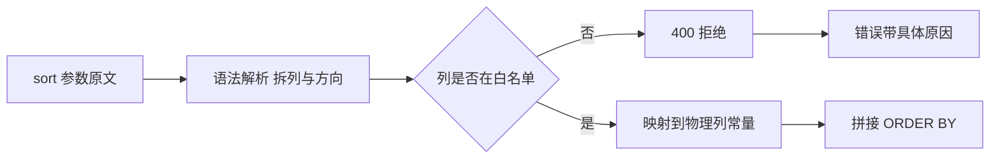

### Q2166 · 多列排序参数的语法解析

> 难度:★★☆☆ | 标签:REST, 参数解析

**问**:sort=name,-created_at 这种多列排序参数,解析器要处理哪些细节?

**答**:语法层负责形状、白名单层负责合法性,两层都要在进入 SQL 之前完成。解析器要处理:前缀符号(- 表示 desc,缺省 asc,可选拒绝 +);空段与纯符号段报错;每列都在白名单内;同一列重复出现直接拒绝(静默去重会隐藏调用方的 bug);列数设上限(防止生成病态排序计划);参数总长设上限(防超长输入消耗解析)。产出是统一的 [(列, 方向)] 结构,后续按白名单映射成物理列再拼 ORDER BY。错误一律 400 并带具体原因,让调用方自查而不是猜。

```python
# file: code/03_Web后端开发/q2166_multi_sort_parse.py
"""多列排序参数的语法解析: 白名单校验加方向与上限(纯标准库)。"""

WHITELIST = {"name", "created_at", "price"}
MAX_COLUMNS = 3


class SortParamError(Exception):
    pass


def parse_sort(param):
    """解析 'name,-created_at' 形态; 返回 [(列, 方向)]。"""
    if param is None or param == "":
        return [("created_at", "desc")]
    if len(param) > 128:
        raise SortParamError("排序参数过长")
    seen = []
    for token in param.split(","):
        token = token.strip()
        if not token:
            raise SortParamError("空排序段")
        direction = "asc"
        if token[0] in "+-":
            direction = "desc" if token[0] == "-" else "asc"
            token = token[1:]
        if not token:
            raise SortParamError("纯符号的排序段")
        if token not in WHITELIST:
            raise SortParamError("未知排序字段: " + token)
        if any(t[0] == token for t in seen):
            raise SortParamError("重复排序字段: " + token)
        seen.append((token, direction))
        if len(seen) > MAX_COLUMNS:
            raise SortParamError("最多允许 {} 列".format(MAX_COLUMNS))
    return seen


def to_order_by(parsed):
    return ", ".join("{} {}".format(col, d.upper()) for col, d in parsed)


for raw in [None, "name", "-price", "name,-created_at,price", "name,-created_at,price,rating"]:
    try:
        print("{!r:34s} -> ORDER BY {}".format(raw, to_order_by(parse_sort(raw))))
    except SortParamError as exc:
        print("{!r:34s} -> 400: {}".format(raw, exc))
for bad in ["name,-name", "name;DROP TABLE x", "-", "name,,"]:
    try:
        parse_sort(bad)
        print("漏网!", bad)
    except SortParamError as exc:
        print("{!r:22s} -> 400: {}".format(bad, exc))
print("要点: 语法层管形状, 白名单管合法性, 重复列与列数上限都要显式拒绝")
```

**追问**:
- 为什么重复列要报错而不是去重?——重复通常意味着调用方拼参数的代码有 bug,静默去重会把问题拖到生产才暴露。
- 方向符号用 - 还是 asc/desc 关键字?——紧凑符号对 URL 友好,关键字更易读;关键是全库统一,不要两种混用。


