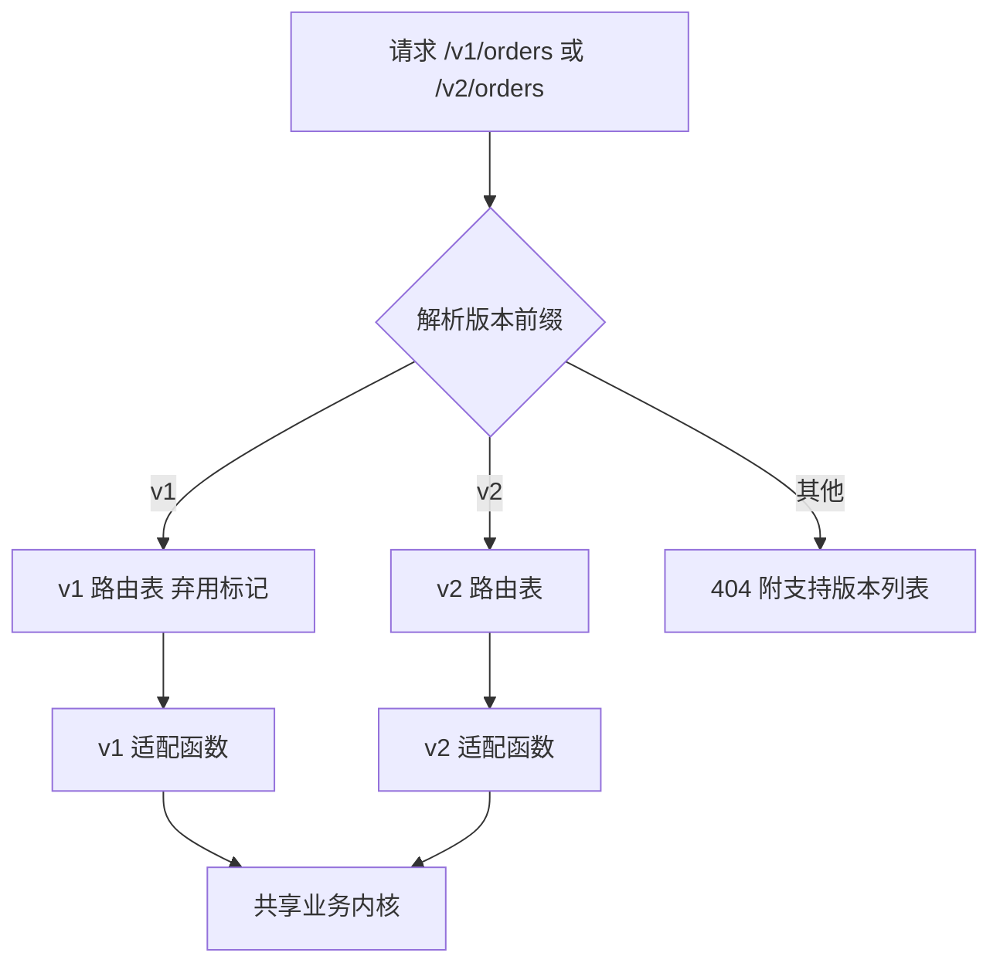

### Q2171 · API 版本双运行路由

> 难度:★★★☆ | 标签:版本管理, 路由

**问**:v1 和 v2 同时在线,路由层怎么组织才不会失控?

**答**:单位是"版本路由表 + 版本适配函数",业务内核全局只有一份。每个版本一张独立的路由表(path 到处理名的映射),入口先解析版本前缀,再查对应表分发给该版本的适配函数;适配函数负责把领域模型转换成该版本的线格式。这个结构有三个收益:双运行的存活边界清晰——v1 表存在即服务,下线就是删表;版本差异收口在适配函数,handler 不出现 if version == 'v1';未知版本统一 404 并返回支持的版本列表,方便调用方发现。配套要有按版本的流量指标与弃用标记,双运行期间 v1 的调用量就是迁移进度的直接读数。

```python
# file: code/03_Web后端开发/q2171_dual_version_router.py
"""API 版本双运行: 路由表按版本隔离, 业务内核全局共享(纯标准库)。"""

V1_TABLE = {("GET", "/orders"): "order_v1"}
V2_TABLE = {("GET", "/orders"): "order_v2", ("GET", "/orders/stats"): "stats_v2"}


def order_core(payload):
    """业务内核与版本无关, 版本差异只在出口适配。"""
    return {"id": payload.get("id", "o-100"), "amount_cents": 9900,
            "tax_cents": 900, "state": "paid"}


def order_v1(payload):
    data = order_core(payload)
    return 200, {"id": data["id"], "amount": data["amount_cents"] // 100,
                 "state": data["state"]}


def order_v2(payload):
    data = order_core(payload)
    return 200, {"id": data["id"], "amount_cents": data["amount_cents"],
                 "tax_cents": data["tax_cents"], "state": data["state"]}


def stats_v2(payload):
    return 200, {"total": 42}


HANDLERS = {"order_v1": order_v1, "order_v2": order_v2, "stats_v2": stats_v2}
ROUTES = {"v1": V1_TABLE, "v2": V2_TABLE}


def dispatch(method, path):
    parts = path.lstrip("/").split("/", 1)
    version, rest = parts[0], "/" + (parts[1] if len(parts) > 1 else "")
    table = ROUTES.get(version)
    if table is None:
        return 404, {"error": "unknown_version", "supported": sorted(ROUTES)}
    if (method, rest) not in table:
        return 404, {"error": "no_route", "version": version}
    return HANDLERS[table[(method, rest)]]({"id": "o-100"})


for method, path in [("GET", "/v1/orders"), ("GET", "/v2/orders"),
                     ("GET", "/v2/orders/stats"), ("POST", "/v1/orders"),
                     ("GET", "/v3/orders")]:
    print("{} {:18s} ->".format(method, path), dispatch(method, path))
assert dispatch("GET", "/v2/orders")[1]["amount_cents"] == 9900
print("要点: 双运行的单位是路由表与适配函数, 业务内核只有一份; v1 表存在即服务, 下线只是删表")
```

**追问**:
- 双运行期间数据库 schema 怎么办?——schema 以两个版本的最大兼容面为准,先扩后收,与发布兼容两阶段配合。
- 版本放 URL 前缀还是 header?——URL 前缀便于路由与调试,header 更 REST 纯粹但缓存与网关配置更麻烦;选定一种全站统一。


