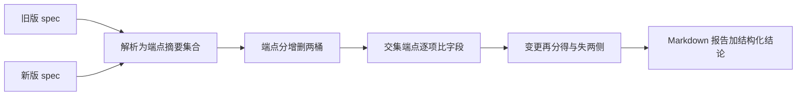

### Q2176 · schema diff 报告生成

> 难度:★★★★ | 标签:契约, 工具链

**问**:发版评审要一份新旧 OpenAPI 的差异报告,生成器怎么组织?报告给谁看?

**答**:生成器分三步:把两份 spec 解析成统一的"端点摘要"(路径、方法、参数、响应字段);对端点集合做增删分桶,对交集端点逐项比较参数与响应字段,变更再分"新增/失去"两侧;最后渲染成人类可读的 Markdown,按新增、删除、变更分组,变更条目里显式标出 +字段 与 -字段。报告有两个读者:评审人看分组与破坏点,机器(门禁)看结构化结论,所以生成器同时输出文本报告和结构化 findings,文本可以丢、结构不能丢。与漂移检测的区别要讲清:diff 比较的是两个版本的 spec(发布评审视角),漂移检测比较的是实现与 spec(一致性视角),两者互补。

```python
# file: code/03_Web后端开发/q2176_schema_diff_report.py
"""schema diff 报告生成: 对比两版接口摘要并输出 Markdown(纯标准库)。"""

OLD = {
    "GET /v1/orders": {"params": {"status"}, "resp_fields": {"id", "total", "state"}},
    "GET /v1/orders/{id}": {"params": set(), "resp_fields": {"id", "total", "state", "coupon"}},
}
NEW = {
    "GET /v1/orders": {"params": {"status", "limit"},
                       "resp_fields": {"id", "total", "state", "channel"}},
    "GET /v1/orders/{id}": {"params": set(), "resp_fields": {"id", "total", "state"}},
    "POST /v1/orders": {"params": set(), "resp_fields": {"id"}},
}


def diff_specs(old, new):
    lines = ["# API Schema Diff", ""]
    added = sorted(set(new) - set(old))
    removed = sorted(set(old) - set(new))
    if added:
        lines.append("## 新增端点")
        lines += ["- `{}`".format(p) for p in added]
    if removed:
        lines.append("## 删除端点(破坏性)")
        lines += ["- `{}`".format(p) for p in removed]
    lines.append("## 变更端点")
    for path in sorted(set(old) & set(new)):
        for key in ("params", "resp_fields"):
            gains = new[path][key] - old[path][key]
            losses = old[path][key] - new[path][key]
            if gains or losses:
                lines.append("- `{}` {}: +{} -{}".format(
                    path, key, sorted(gains) or "-", sorted(losses) or "-"))
    return "\n".join(lines)


report = diff_specs(OLD, NEW)
print(report)
assert "删除端点" not in report and "coupon" in report
print()
print("要点: 先分桶后比字段, 变更条目显式标得失; 同时产出文本报告与结构化结论, 评审看文本门禁看结构")
```

**追问**:
- 响应字段顺序变了要报吗?——不报,字段集合比较无序;数组参数顺序、必填性变化才进报告。
- 报告的基线怎么定?——上一个已发布 tag 的 spec,而不是主干上的旧文件,保证 diff 只包含本次变更。


