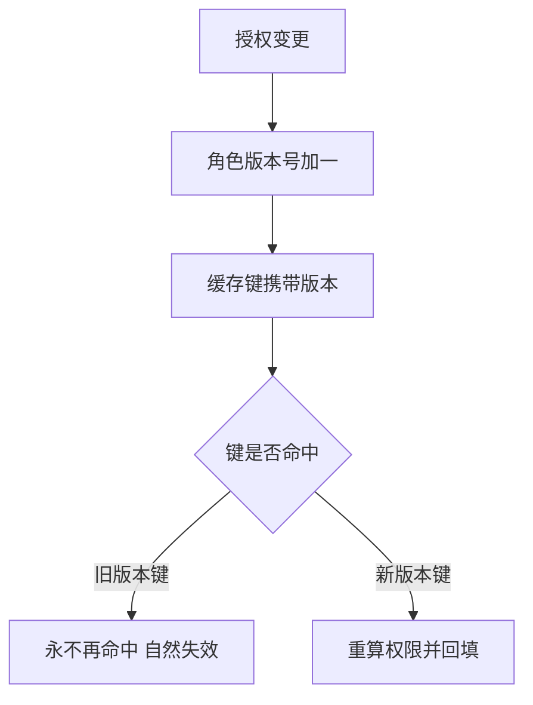

### Q2181 · 权限缓存失效的版本号方案

> 难度:★★★☆ | 标签:安全, 缓存

**问**:权限缓存怎么做到授权变更立即生效,而不是等 TTL?

**答**:版本号方案把"删除一批缓存"变成"换一个键":每个角色维护一个单调递增的版本号,缓存键携带角色版本;授权变更时版本号加一,所有旧键自然失效——不需要遍历删除,旧条目留在缓存里也无害,因为永远不会再被命中,由 LRU 或 TTL 兜底清理。粒度可调:角色级版本影响面小但要看清角色与用户的关系(用户键仍需组合),全局 epoch 一改全部失效,适合授权模型大改。配合要点:版本号本身要在多实例间一致(放共享存储),版本读取要在同一次请求内固定(否则一半请求新版本一半旧版本);版本号递增与角色写入要原子,否则存在"数据已变版本未变"的窗口。

```python
# file: code/03_Web后端开发/q2181_permission_cache_version.py
"""权限缓存失效的版本号方案: 角色版本进键, 变更即失效(纯标准库)。"""


class VersionedAuthz:
    def __init__(self):
        self.role_version = {"viewer": 1}
        self.roles = {"viewer": frozenset({"read"})}
        self.cache = {}

    def permissions(self, user_id, role):
        key = (user_id, role, self.role_version[role])
        hit = self.cache.get(key)
        if hit is not None:
            return hit, "cache"
        perms = self.roles.get(role, frozenset())
        self.cache[key] = perms
        return perms, "computed"

    def grant_role(self, role, perms):
        """递增版本号使旧键全部自然失效; 旧条目留给 LRU/TTL 兜底清理。"""
        self.roles[role] = frozenset(perms)
        self.role_version[role] += 1


svc = VersionedAuthz()
print("变更前        :", svc.permissions("u1", "viewer"))
svc.grant_role("viewer", {"read", "export"})
print("变更后立即查  :", svc.permissions("u1", "viewer"))
print("同版本再查    :", svc.permissions("u1", "viewer")[1])
assert svc.permissions("u1", "viewer")[0] == frozenset({"read", "export"})
print("要点: 版本号把删一批缓存变成换一个键, 失效是 O(1) 写操作; 全局 epoch 适合授权大改的一键失效")
```

**追问**:
- 版本号方案有没有失效盲区?——有,版本读取与权限使用不在同一请求快照时会出现新旧混用,读版本要用请求级缓存固定。
- 用户与角色是多层关系怎么办?——键里带用户生效版本加角色版本,或干脆用全局 epoch 换简单性。


