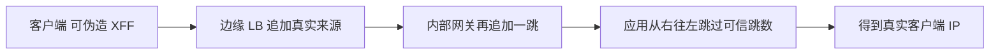

### Q2186 · X-Forwarded-For 的信任链解析

> 难度:★★★☆ | 标签:安全, 部署

**问**:从 X-Forwarded-For 取真实客户端 IP,为什么直接取第一个会出事故?

**答**:XFF 是逐跳追加的列表:每个可信代理把"它看到的对端地址"追加到右侧,但客户端可以在初始请求里自带任意 XFF——所以列表左侧的内容完全由攻击者控制,取第一个等于信任攻击者输入。正确算法是从右往左数:跳过 N 个可信代理各自追加的一跳(N 是从应用到公网的代理层数,部署拓扑决定),倒数第 N 个就是真实客户端 IP;跳数不足说明请求绕过了代理直连,要按伪造处理(取对端地址或拒绝)。配套约束:每一层代理都必须追加而不是透传修改,最内层应用配置的可信代理数必须与真实拓扑一致,拓扑变更时同步更新。限流、审计、风控都依赖这个 IP,取错会同时破坏这三者。

```python
# file: code/03_Web后端开发/q2186_xff_trust_chain.py
"""X-Forwarded-For 的信任链: 从右往左跳过可信代理数(纯标准库)。"""

TRUSTED_PROXIES = 2                                    # 边缘 LB + 内部网关


def client_ip(xff_header, remote_addr):
    """remote_addr 是 TCP 对端, 是唯一无条件可信的地址。"""
    if not xff_header:
        return remote_addr, "无 XFF, 直接取对端"
    hops = [h.strip() for h in xff_header.split(",")]
    if len(hops) < TRUSTED_PROXIES:
        return remote_addr, "跳数不足, 疑似绕过代理, 保守取对端"
    return hops[-TRUSTED_PROXIES], "取倒数第 {} 跳".format(TRUSTED_PROXIES)


cases = [
    ("9.9.9.9, 10.0.0.3", "10.0.0.3", "正常两级代理"),
    ("6.6.6.6, 9.9.9.9, 10.0.0.3", "10.0.0.3", "客户端自带伪造头"),
    ("6.6.6.6", "10.0.0.9", "直连伪造跳数不足"),
    (None, "10.0.0.9", "直连无 XFF"),
]
for xff, remote, label in cases:
    ip, why = client_ip(xff, remote)
    print("{:12s} XFF={!r:30s} -> {} ({})".format(label, xff, ip, why))
assert client_ip("6.6.6.6, 9.9.9.9, 10.0.0.3", "10.0.0.3")[0] == "9.9.9.9"
print("要点: 每个可信代理追加一跳, 真实 IP 在倒数第 N 跳; 取第一跳等于信任攻击者的输入")
```

**追问**:
- 用 X-Real-IP 是不是就安全?——不一定,它同样只是上游写入的一个头,安全性取决于写入者是否可信与是否覆盖而非头名。
- 限流键用这个 IP 有什么坑?——NAT 与移动网络下大量用户共享 IP,要按 IP 加用户维度组合限流。


