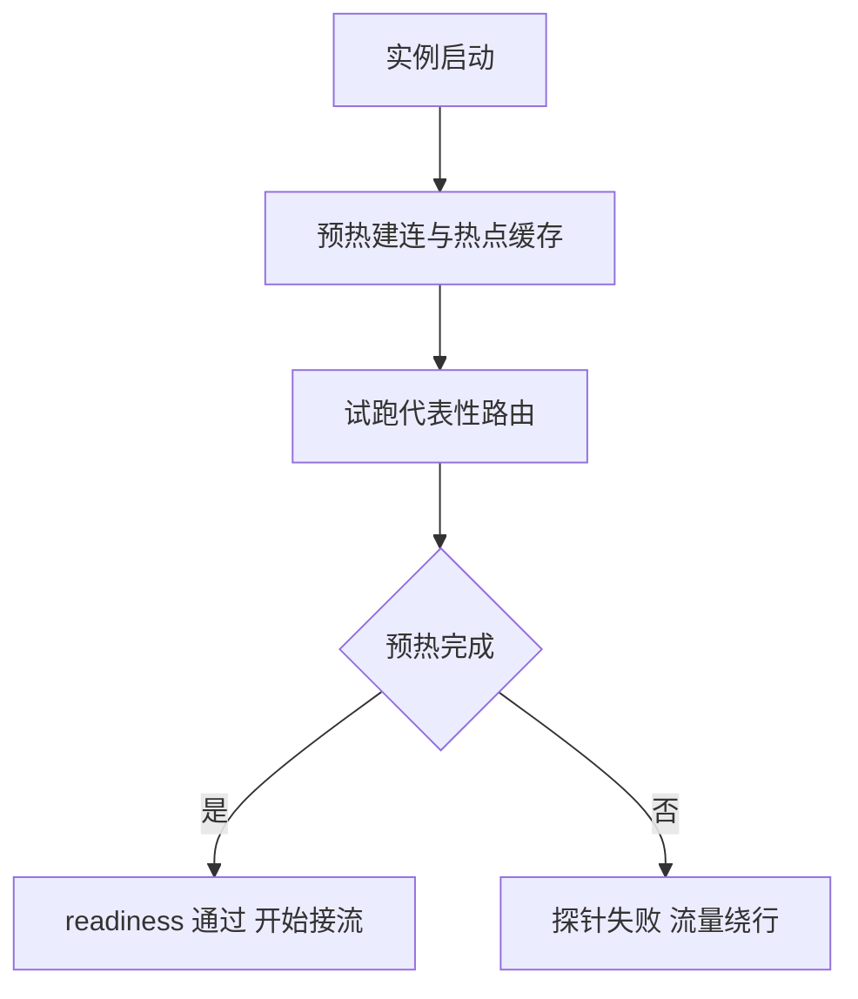

### Q2191 · 冷启动预热脚本

> 难度:★★★☆ | 标签:部署, 性能

**问**:新实例为什么头几个请求特别慢?预热脚本要预热哪些东西?

**答**:冷启动的"税"有三类:连接类(数据库、Redis、下游的连接池建立与 TLS 握手)、缓存类(热点数据首次回源、本地缓存为空)、路径类(首次执行的代码触发惰性导入、序列化器注册、JIT 与路由编译)。预热脚本就是把这三类税提前交:启动后、接流量前,主动建立连接池、把热点键拉进缓存、对代表性路由各发一次真实调用走完完整处理路径。关键是预热必须与就绪探针联动——预热完成前 readiness 返回失败,流量绕行;预热清单要数据驱动(从访问日志取 top 路由与热点键),而不是开发凭感觉写死。没有预热的实例上量,首批请求的超时与重试还会引发连锁反应。

```python
# file: code/03_Web后端开发/q2191_warmup_script.py
"""冷启动预热脚本: 连接、缓存与路由三类预热加就绪门禁(纯标准库)。"""
import time


class App:
    def __init__(self):
        self.db_ready = False
        self.cache = {}
        self.route_cache = set()
        self.cold_cost = {}

    def query_db(self, key):
        t0 = time.time()
        time.sleep(0.01)                            # 模拟建连加查询
        self.cold_cost.setdefault(key, round((time.time() - t0) * 1000, 1))
        return "data-" + key

    def warm(self, hot_keys, routes):
        """预热三件事: 连接池、热点缓存、代表性路由的完整处理路径。"""
        self.db_ready = True                        # 预建连接(以标志模拟)
        for key in hot_keys:
            self.cache[key] = self.query_db(key)
        for route in routes:
            self.route_cache.add(route)

    def ready(self, hot_keys, routes):
        return (self.db_ready
                and all(k in self.cache for k in hot_keys)
                and all(r in self.route_cache for r in routes))


hot, routes = ["hot1", "hot2"], ["GET /orders", "GET /goods"]
app = App()
t0 = time.time()
app.warm(hot, routes)
print("预热耗时: {}ms, 就绪判定: {}".format(round((time.time() - t0) * 1000, 1),
                                            app.ready(hot, routes)))
cold = App()
print("未预热实例就绪判定:", cold.ready(hot, routes), "-> 不该接流量")
assert app.ready(hot, routes) and not cold.ready(hot, routes)
print("要点: 预热交的是首请求的税——建连、热点数据、完整处理路径; readiness 以预热完成为门禁")
```

**追问**:
- 预热调用会不会污染统计?——预热请求打独立标记,在指标里排除,避免拉低 P95 的真实性。
- 热点键清单从哪来?——访问日志统计 top 键与 top 路由,按周期回填预热配置,并监控预热命中率。


