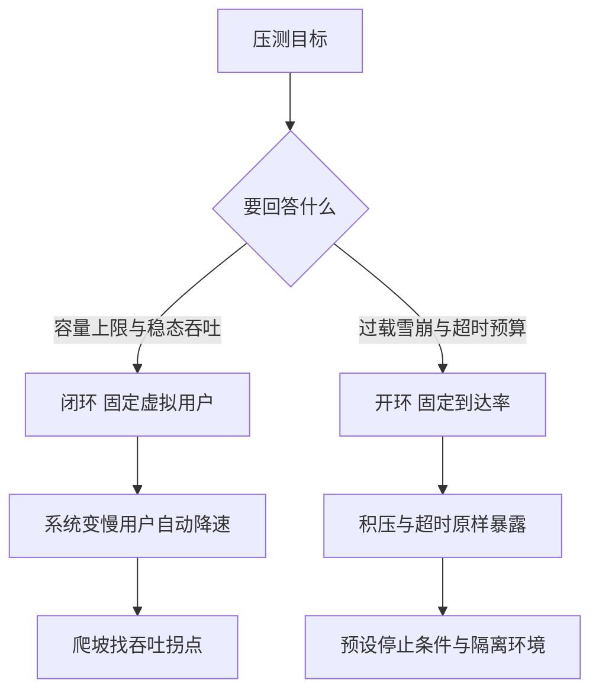

### Q2196 · 接口回归用例自动生成:从契约出发

> 难度:★★☆☆ | 标签:测试, 自动化

**问**:接口一多回归测不过来,从接口契约自动生成用例的思路是什么?

**答**:契约(OpenAPI 或内部的接口注册表)已经声明了路径、方法、必填参数与类型,自动生成的下限用例就藏在里面:每个端点生成一条正向用例(全部必填参数按类型采样),再对每个必填字段生成一条"缺失该字段应得 400"的负向用例——这是性价比最高的负向矩阵,字段增删会自动反映到用例集,契约改了用例跟着改,保证回归集与契约不漂移。生成器的产出是可执行的用例骨架与参数矩阵,业务语义断言(返回内容对不对)仍要人补,但覆盖率的下限由机器保证。工程上配合两件事:生成的用例带来源标注(哪个契约版本生成),便于失效追溯;对生成用例设置独立目录,避免与手写用例混在一起评审。

```python
# file: code/03_Web后端开发/q2196_case_autogen.py
"""接口回归用例自动生成: 从契约生成正向与必填缺失用例(纯标准库)。"""

CONTRACT = [
    {"endpoint": "POST /v1/goods", "required": ["name", "price"]},
    {"endpoint": "GET /v1/goods/{id}", "required": ["id"]},
]
SAMPLES = {"name": "demo", "price": 9.9, "id": "g-1"}


def gen_cases(spec):
    """正向一条, 每个必填字段缺失一条。"""
    cases = [{"name": "happy_path",
              "params": {k: SAMPLES.get(k, "x") for k in spec["required"]},
              "expect_status": 200}]
    for field in spec["required"]:
        params = {k: SAMPLES.get(k, "x") for k in spec["required"] if k != field}
        cases.append({"name": "missing_" + field, "params": params,
                      "expect_status": 400, "assert_field": field})
    return cases


total = 0
for spec in CONTRACT:
    print("##", spec["endpoint"])
    for case in gen_cases(spec):
        total += 1
        print("  test_{}_{:16s} params={} expect={}".format(
            spec["endpoint"].split()[0].lower(), case["name"],
            case["params"], case["expect_status"]))
print("共生成 {} 条用例; 契约即用例来源, 字段增删自动反映到回归集".format(total))
assert total == 5
print("要点: 自动生成保证覆盖率下限——每必填字段一条缺失用例; 业务语义断言仍要人补")
```

**追问**:
- 生成的用例会有很多冗余吗?——会有,按端点去重与参数采样控制规模,重点是下限而不是完备。
- 契约没写的参数要不要测?——要,额外生成"多余参数被忽略"用例,验证容错读取者语义。


