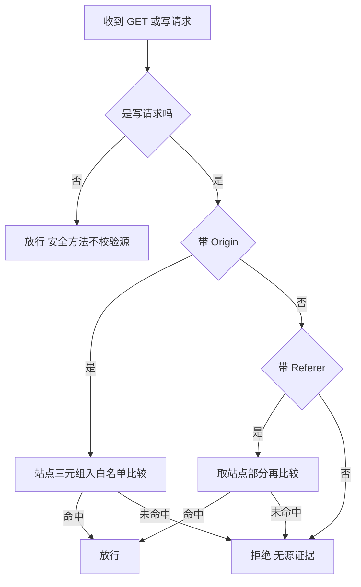

### Q2430 · Origin 与 Referer 的语义差异与源校验

> 难度:★★☆☆ | 标签:HTTP, CSRF, 安全头

**问**:做 CSRF 源校验时,Origin 和 Referer 有什么语义差异?为什么优先信 Origin?

**答**:Origin 的值只有 scheme://host:port 三元组,天生不含路径与查询,隐私面小,而且现代浏览器对 CORS 请求与所有非 GET 请求一律携带,可预测性强。Referer 是完整 URL,可能带路径参数,还受 Referrer-Policy 控制——策略设成 no-referrer 时它会被整个剥掉,你的校验逻辑瞬间失去输入。所以源校验的正确姿势是:优先取 Origin 与白名单比较,Origin 缺失时退回 Referer 取其站点部分,两者都没有的写请求直接拒绝;GET 等安全方法不做源校验,因为顶层导航本来就该允许无源进入。比较必须在站点粒度做规范化,默认端口 443 与 80 要归一,否则同站会因端口书写差异被误拒。

```python
# file: code/03_Web后端开发/q2430_origin_referer.py
"""Origin 与 Referer 的语义差异与 CSRF 源校验(纯标准库)。"""
from urllib.parse import urlsplit


def site_of(url):
    """取 scheme://host:port 站点粒度, 不含路径与查询。"""
    parts = urlsplit(url)
    netloc = parts.netloc.lower()
    if parts.scheme == "https" and parts.port == 443:
        netloc = netloc.split(":")[0]          # 规范化默认端口
    if parts.scheme == "http" and parts.port == 80:
        netloc = netloc.split(":")[0]
    return "{}://{}".format(parts.scheme.lower(), netloc)


def check_csrf(headers, method, allowed_sites):
    """CSRF 敏感方法的源校验: 优先 Origin, 退而求 Referer, 都没有则拒绝。"""
    if method not in ("POST", "PUT", "PATCH", "DELETE"):
        return True, "安全方法不做源校验"
    if "Origin" in headers:
        src = "Origin"
        got = site_of(headers["Origin"])
    elif "Referer" in headers:
        src = "Referer"
        got = site_of(headers["Referer"])
    else:
        return False, "无源信息, 拒绝"
    if got in allowed_sites:
        return True, "{} 源 {} 在白名单".format(src, got)
    return False, "{} 源 {} 不在白名单".format(src, got)


ALLOWED = {"https://app.example.com", "https://www.example.com"}

cases = [
    # 请求头, 方法, 期望
    ({"Origin": "https://app.example.com"}, "POST", True),
    ({"Origin": "https://evil.example.com"}, "POST", False),
    ({"Referer": "https://www.example.com/account/settings?tab=2"}, "POST", True),
    ({"Referer": "http://www.example.com/x"}, "POST", False),          # scheme 不同
    ({}, "POST", False),                                               # 两者都没有
    ({}, "GET", True),
    ({"Origin": "https://www.example.com:443/x/y"}, "POST", True),     # Origin 带路径时只取站点
]
for headers, method, expect in cases:
    ok, why = check_csrf(headers, method, ALLOWED)
    print("{:<4} {:34s} -> {}".format(method, str(headers), why))
    assert ok == expect, (headers, method, ok, why)

# 语义差异要点
assert site_of("https://www.example.com/a/b?c=1") == "https://www.example.com"
print("要点: Origin 只有站点三元组且 CORS 与非 GET 请求必带; "
      "Referer 带完整路径可被 Referrer-Policy 剥掉, 所以安全校验优先信 Origin")
```

**追问**:
- 旧浏览器或某些跳转场景两者都没有怎么办?——那是历史包袱,现代方案以 CSRF Token 兜底,不能把安全建立在可能缺失的头之上。
- Referrer-Policy: strict-origin-when-cross-origin 对校验的影响?——跨站 Referer 被降级成 Origin 粒度,站点级比较依然可用,但任何依赖路径的校验都会失效。


