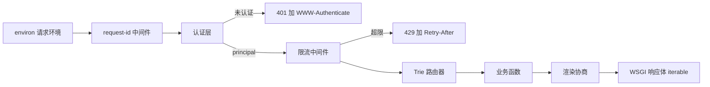

### Q2435 · 可插拔认证层的方案注册与质询

> 难度:★★★☆ | 标签:认证, Bearer, Basic

**问**:设计一个认证层,同时支持 Bearer、Basic、ApiKey 三种方案,新方案怎么做到注册即用?

**答**:把"方案"抽象成三元组:名称、解析函数、质询串。认证层维护注册表,收到请求后按 Authorization 头的 scheme 前缀分派给对应解析函数,解析函数只做一件事——把凭证换算成 principal(用户或服务身份),返回 None 表示认证失败。新增方案就是注册一个新三元组,核心流程零改动,这就是可插拔的含义。401 响应必须回带 WWW-Authenticate,值由注册表拼接,告诉客户端服务端支持哪些方案;分派不到方案时不报 500 而是走 401 语义。两个安全细节:Basic 的密码比较用常数时间比较函数;解析函数永不抛异常,坏编码返回 None 而不是炸掉请求。认证层只负责"你是谁",授权("你能干什么")是独立的下一层。

```python
# file: code/03_Web后端开发/q2435_pluggable_auth.py
"""可插拔认证层: 方案注册、逐级协商与质询(纯标准库)。"""
import base64
import binascii
import hashlib
import hmac

TOKENS = {"tok-alice-1": "alice"}
USERS = {"alice": "wonderland"}


class AuthLayer:
    def __init__(self):
        self.schemes = []                       # (名称, 解析函数, 质询串)

    def register(self, name, resolver, challenge):
        self.schemes.append((name.lower(), resolver, challenge))
        return self                             # 链式注册

    def authenticate(self, headers):
        """按 Authorization 头的 scheme 前缀分派, 返回 principal 或 None。"""
        raw = headers.get("Authorization", "")
        scheme, _, credential = raw.partition(" ")
        for name, resolver, _ in self.schemes:
            if scheme.lower() == name:
                return resolver(credential)
        return None

    def www_authenticate(self):
        """401 响应的 WWW-Authenticate 值: 列出全部已注册方案。"""
        return ", ".join(ch for _, _, ch in self.schemes)


def bearer_resolver(credential):
    return TOKENS.get(credential)


def basic_resolver(credential):
    try:
        decoded = base64.b64decode(credential).decode()
        user, _, pwd = decoded.partition(":")
    except (binascii.Error, UnicodeDecodeError):
        return None
    expected = USERS.get(user)
    if expected and hmac.compare_digest(expected, pwd):
        return user
    return None


def apikey_resolver(credential):
    return ("service-" + credential[3:7]) if credential.startswith("sk-") else None


auth = (AuthLayer()
        .register("Bearer", bearer_resolver, 'Bearer realm="api"')
        .register("Basic", basic_resolver, 'Basic realm="api"')
        .register("ApiKey", apikey_resolver, "ApiKey"))

cases = [
    ({"Authorization": "Bearer tok-alice-1"}, "alice"),
    ({"Authorization": "Basic " + base64.b64encode(b"alice:wonderland").decode()}, "alice"),
    ({"Authorization": "Basic " + base64.b64encode(b"alice:wrong").decode()}, None),
    ({"Authorization": "ApiKey sk-demo123"}, "service-demo"),
    ({"Authorization": "Digest aaa"}, None),
    ({}, None),
]
for headers, expect in cases:
    got = auth.authenticate(headers)
    label = headers.get("Authorization", "无头")
    print("{:24s} -> {}".format(label[:24], got))
    assert got == expect, (label, got, expect)

status = 401 if auth.authenticate({}) is None else 200
assert status == 401
print("401 响应头 WWW-Authenticate:", auth.www_authenticate())
print("要点: 认证层只做 身份解析 不做授权, 新方案注册即用; "
      "401 必须回带 WWW-Authenticate 告知客户端支持的方案")
```

**追问**:
- 为什么 401 与 403 必须区分?——401 是"不知道你是谁"带 WWW-Authenticate 引导认证,403 是"知道你是谁但没权限",混用会让客户端重试逻辑失灵。
- ApiKey 方案要不要走 Authorization 头?——建议走,自定义头会绕开标准工具链,统一在 Authorization 里分派便于日志与审计。


