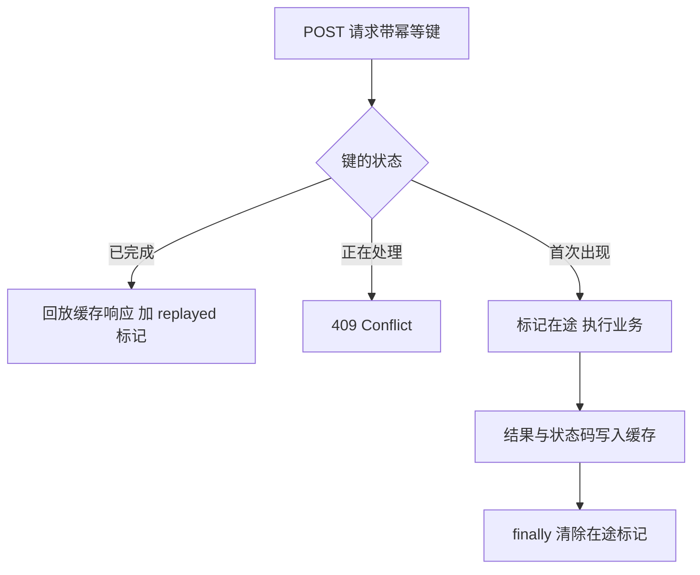

### Q2440 · Trie 路由器:静态段优先于参数段

> 难度:★★★★ | 标签:路由, Trie, 框架原理

**问**:用 Trie 实现一个支持路径参数的路由器,/users/new 与 /users/{uid} 同时注册时怎么裁决?

**答**:把路径按斜杠切段,每段是树的一条边:静态段存进子节点字典,参数段用一个专门的参数子节点接住并记住参数名,handler 挂在叶子。匹配时逐段下行,静态段永远优先于参数段——/users/new 精确命中注册的静态节点,绝不会掉进 {uid} 里变成"查 new 这个用户"。匹配失败的形态有两种:某一段既无静态子节点也无参数位,或者走完了树却停在无 handler 的节点,两种都对应 404。Trie 相比正则列表的优势:匹配复杂度只与路径长度相关、天然拒绝悬空子路径、同一前缀的路由聚合在一起便于挂中间件;FastAPI 与 Gin 的路由内核都是这个模型的变体。

```python
# file: code/03_Web后端开发/q2440_trie_router.py
"""Trie 路由器: 静态段优先于参数段的树匹配(纯标准库)。"""


class Node:
    __slots__ = ("children", "param", "param_name", "handler")

    def __init__(self):
        self.children = {}            # 静态段 -> 子节点
        self.param = None             # 参数段子节点
        self.param_name = None
        self.handler = None


class Router:
    def __init__(self):
        self.root = Node()

    def add(self, path, handler):
        node = self.root
        for seg in path.strip("/").split("/"):
            if seg.startswith("{") and seg.endswith("}"):
                if node.param is None:
                    node.param = Node()
                    node.param_name = seg[1:-1]
                node = node.param
            else:
                node = node.children.setdefault(seg, Node())
        node.handler = handler

    def match(self, path):
        """返回 (handler, 参数字典); 匹配失败返回 (None, None) 对应 404。"""
        params = {}
        node = self.root
        for seg in path.strip("/").split("/"):
            if seg in node.children:               # 静态段永远优先
                node = node.children[seg]
            elif node.param is not None:
                params[node.param_name] = seg
                node = node.param
            else:
                return None, None
        return node.handler, params


router = Router()
router.add("/users/{uid}/posts", lambda params: "posts of {}".format(params["uid"]))
router.add("/users/new", lambda params: "create form")
router.add("/users/{uid}", lambda params: "user {}".format(params["uid"]))
router.add("/health", lambda params: "ok")

cases = [("/users/42/posts", "posts of 42"),
         ("/users/new", "create form"),          # 静态段优先于参数段
         ("/users/42", "user 42"),
         ("/health", "ok")]
for path, expect in cases:
    handler, params = router.match(path)
    got = handler(params) if handler else None
    print("{:20s} -> {} params={}".format(path, got, params))
    assert got == expect, (path, got, expect)

handler, params = router.match("/orders/9")
assert handler is None and params is None
print("/orders/9        -> 404  未注册的顶层段无处可去")
handler, params = router.match("/users/42/posts/99")
assert handler is None
print("/users/42/posts/99 -> 404  树比正则更容易发现多出的段")
print("要点: Trie 路由把 段 变成树的边, 静态优先参数兜底, "
      "参数名只在参数节点上记一次, 匹配过程天然拒绝悬空子路径")
```

**追问**:
- 参数段出现在同一位置的不同参数名怎么办?——如 /users/{uid} 与 /users/{name} 冲突,注册时应当报错,一个位置只允许一个参数名。
- 尾部斜杠算不算同一路由?——设计决定:要么归一化后等价,要么严格区分并 308 重定向,关键是全局一致。


