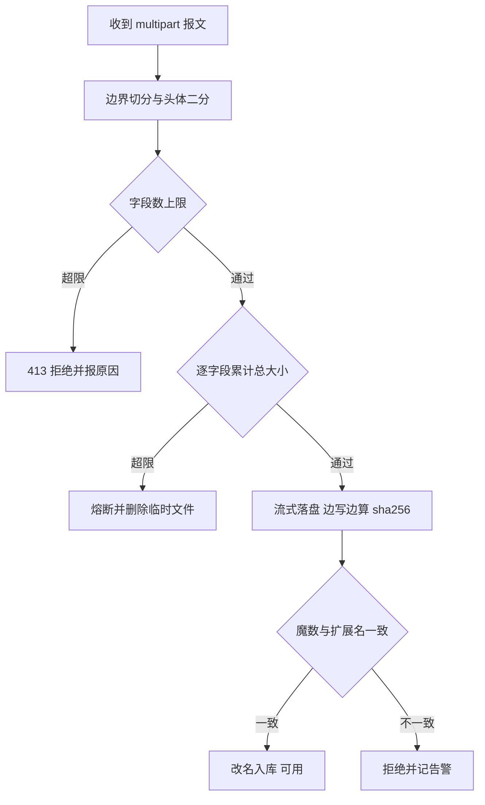

### Q2445 · CSV 导入的流式校验与错误配额

> 难度:★★★☆ | 标签:CSV, 数据校验, 流式处理

**问**:导入一个几百万行的 CSV,怎么做到内存不随文件涨、脏数据快速失败?

**答**:流式校验的内存模型只有两个常量结构:累积错误列表(带行号、列名、原因)与已见唯一键集合,行数据用完即弃。先验表头:必填列缺失直接整体拒绝,不用逐行白跑。逐行按列校验:必填、类型、值域、唯一性,错误进列表;设错误配额(如三条),达到即提前终止——用户拿到的首批错误足够修一轮,服务端也不必陪脏文件跑完全程。行号从表头后计起,要提醒用户多行字段会让行号偏移。唯一键检查用集合内存换速度,几百万行的 uid 集合仍在几十 MB 量级;更大规模就把已见键放进数据库临时表做批量去重。这套结构同样适用于 Excel 导入与 ETL 抽检。

```python
# file: code/03_Web后端开发/q2445_csv_stream_validate.py
"""CSV 导入的流式校验: 逐行验证 唯一性检查 错误配额提前终止(纯标准库)。"""
import csv
import io

REQUIRED = ["uid", "age", "email"]
MAX_ERRORS = 3


def validate_stream(row_iter, now_rows=None):
    """row_iter 是按行产出的文本迭代器, 模拟逐行读取大文件。"""
    errors, seen, ok_count = [], set(), 0
    reader = csv.DictReader(row_iter)
    if reader.fieldnames is None:
        return 0, [{"line": 1, "field": None, "message": "空文件"}]
    missing_cols = [c for c in REQUIRED if c not in (reader.fieldnames or [])]
    if missing_cols:
        return 0, [{"line": 1, "field": None,
                    "message": "表头缺少必填列: " + ",".join(missing_cols)}]
    for row_no, row in enumerate(reader, start=2):
        if len(errors) >= MAX_ERRORS:
            errors.append({"line": None, "field": None,
                           "message": "错误数达到配额 {}, 提前终止".format(MAX_ERRORS)})
            break
        problem = None
        for col in REQUIRED:
            if not (row.get(col) or "").strip():
                problem = {"line": row_no, "field": col, "message": "必填列缺失"}
                break
        if problem is None and not row["age"].isdigit():
            problem = {"line": row_no, "field": "age", "message": "年龄必须是整数"}
        elif problem is None and not 0 <= int(row["age"]) <= 120:
            problem = {"line": row_no, "field": "age", "message": "年龄必须在 0..120"}
        elif problem is None and "@" not in row["email"]:
            problem = {"line": row_no, "field": "email", "message": "邮箱格式不合法"}
        elif problem is None and row["uid"] in seen:
            problem = {"line": row_no, "field": "uid", "message": "uid 重复"}
        if problem:
            errors.append(problem)
        else:
            seen.add(row["uid"])
            ok_count += 1
    return ok_count, errors


good_csv = "uid,age,email\nu1,30,a@x.com\nu2,41,b@x.com\n"
bad_csv = ("uid,age,email\n"
           "u1,30,a@x.com\n"
           ",25,c@x.com\n"          # 缺 uid
           "u2,abc,d@x.com\n"       # 年龄非数字
           "u1,30,e@x.com\n"        # uid 重复
           "u3,999,f@x.com\n"       # 年龄越界
           "u9,20,g@x.com\n")       # 配额已满, 不再校验

n_ok, errs = validate_stream(io.StringIO(good_csv))
print("合法文件: 通过 {} 行, 错误 {}".format(n_ok, errs))
assert n_ok == 2 and errs == []

n_ok2, errs2 = validate_stream(io.StringIO(bad_csv))
print("非法文件: 通过 {} 行".format(n_ok2))
for e in errs2:
    print("  行 {} 字段 {}: {}".format(e["line"], e["field"], e["message"]))
assert n_ok2 == 1
assert len(errs2) == MAX_ERRORS + 1 and errs2[-1]["field"] is None
assert [e["field"] for e in errs2[:3]] == ["uid", "age", "uid"]

n_ok3, errs3 = validate_stream(io.StringIO("id,note\n1,hi\n"))
assert n_ok3 == 0 and "表头缺少必填列" in errs3[0]["message"]
print("要点: 流式校验只保留 累积错误列表 与 已见键集合, 内存不随文件涨; "
      "错误配额让脏文件快速失败, 行号让用户能直接定位")
```

**追问**:
- 错误配额满了后面的合法行怎么办?——本轮全部不导入,修复后整文件重跑,避免半成品数据;要断点续传就得把行号做成检查点。
- CSV 注入(公式开头)在哪一层防?——校验层对以等号、加号开头的单元格打标或转义,属于逐行规则的一种。


